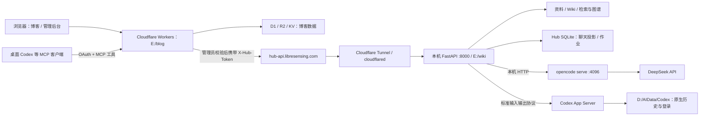
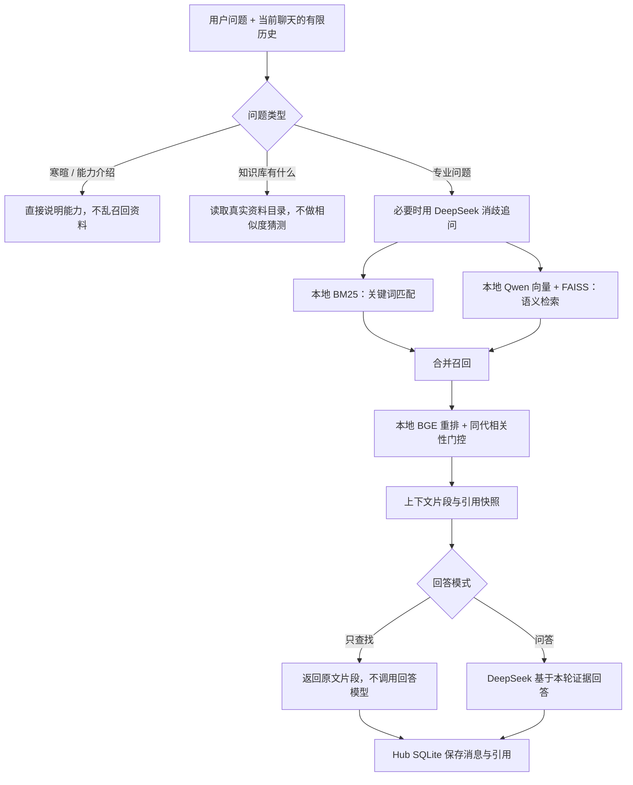
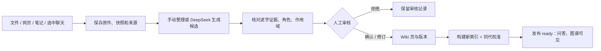
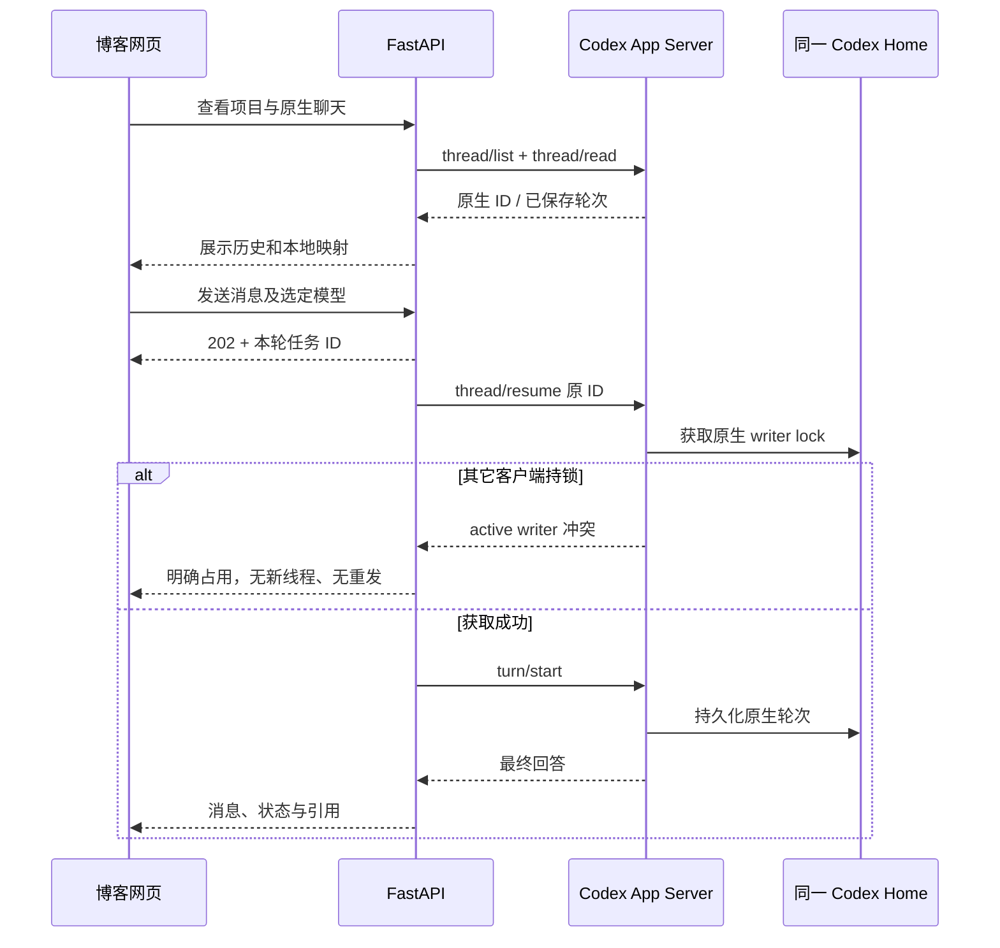

# 博客、个人 Wiki 与本机 Agent：架构和维护说明

> 长期维护文档，核验日期：2026-10-27。代码与部署位置、存储路径、权限和使用方法有变化时，在同一开发任务中更新本文。实施清单与已知问题仍分别维护在 `docs/personal-ai-hub-*.md`。
>
> 用户目标：博客是可以正常操作本机 Codex/opencode 的网页客户端，同时提供自己的 Wiki、知识问答和知识沉淀。Codex 支持聊天、选模型、新建聊天和绑定本地目录；“展示原生能力”不等于只读禁发。不 fork Agent 核心，不另造一份假原生历史。

## 1. 三部分分别做什么

产品上有三个部分：博客、Wiki 知识后端、Agent 后端。部署上还有博客自己的 Cloudflare 服务端，因此不是“一个静态网页直接请求两个裸端口”。

| 部分 | 位置 | 实际职责 | 数据归属 |
| --- | --- | --- | --- |
| 博客与管理后台 | `E:\blog` → Cloudflare Workers → `libresensing.com` | 公开文章、登录、管理员界面、Hub 网页、受保护的服务端代理、博客 MCP | Cloudflare 的 D1、R2、KV 等 |
| Wiki / Personal AI Hub | `E:\wiki`，FastAPI `127.0.0.1:8000` | 原文入库、解析、检索、知识页、引用、知识图谱、聊天投影、后台作业、Agent 编排 | 笔记本的文件和 SQLite |
| 本机 Agent | opencode HTTP `127.0.0.1:4096`；Codex App Server 按需 stdio | 使用模型与工具处理任务，维护原生会话 | 各 Agent 的原生存储，加 Hub 的状态映射 |

Wiki 和 Agent 在逻辑上分开，但前端通过一个 Hub API 访问。Codex 目前没有一个供博客直接访问的常驻 HTTP 端口；FastAPI 启动本机 `codex app-server --stdio`，通过标准协议调用它。



笔记本关机、睡眠、网络断开或 Hub 未启动时，本地能力不可用；公开博客仍由 Cloudflare 提供。系统目前没有自动开机、唤醒笔记本或安装 Hub Windows 服务。

## 2. 博客本体的结构

博客使用 TanStack Start / React 19 渲染页面，Hono 处理网关路由，Drizzle 访问 D1，Better Auth 管理登录。文章、标签、媒体、评论、友链、站点配置、搜索、项目页、版本和通知属于博客功能，不保存在 Wiki 数据库。

管理员 Hub 入口是：

- `/admin/personal-ai-hub`：知识问答、资料库、图谱、待确认知识。
- `/admin/personal-ai-hub/agent-chat`：项目工作区、Codex/opencode 聊天。

对应代码集中在 `src/routes/admin/personal-ai-hub` 和 `src/features/personal-ai-hub`。浏览器调用 TanStack Server Function，经过 `adminMiddleware`；服务端再调用本地 Hub。页面不会获得 `LOCAL_HUB_API_TOKEN`，也不应直接请求 Tunnel 端点。

博客代码推送到 `ShuWisensing/flare-stack-blog` 的 `main` 后，由 `.github/workflows/deploy.yml` 构建、部署 Worker 并清理 CDN。这个过程只部署博客：**不会自动更新或重启笔记本上的 Python、opencode、模型或数据。**

## 3. 外网访问、鉴权和 MCP 的方向

目标链路是：`libresensing.com` 管理员 → 博客服务端代理 → `https://hub-api.libresensing.com` → Tunnel → `127.0.0.1:8000`。

| 配置 | 设置位置 | 作用 |
| --- | --- | --- |
| `PERSONAL_AI_HUB_API_URL` | 博客 Worker 环境 | Hub 公网地址 |
| `PERSONAL_AI_HUB_API_TOKEN` | 博客 Worker Secret | 代理向 Hub 发送的凭据 |
| `LOCAL_HUB_API_TOKEN` | 笔记本系统环境变量 | FastAPI 校验的凭据，须与上项一致 |
| `DEEPSEEK` | 笔记本系统环境变量 | Wiki / opencode 调用 DeepSeek 的 key |
| `HUB_CODEX_HOME` | Hub 启动进程 | 选定的本机 Codex Home，当前为 `D:\AIData\Codex` |
| `HUB_AGENT_TURN_TIMEOUT_SECONDS` | 本机系统变量，可选 | Agent 后台总预算，默认 300 秒，允许 60–1800 秒 |
| `OPENCODE_SERVER_URL` / `OPENCODE_CONFIG` | Hub 启动进程 | 本机 Runtime 地址与 `E:\wiki\opencode.json` |

`/health` 同样需要 `X-Hub-Token`。直接在浏览器打开公网 health 返回 401，说明请求未通过鉴权，不能据此判定服务离线。Tunnel “健康”只说明连接器与 Cloudflare 的连接，不证明 FastAPI、路由地址、token、索引、Agent 或模型全部正常。

校园网需要实测出站连通性；历史上热点可通、校园网失败并不证明全部错误都是网络原因。2026-10-26 已实际查到 Codex 新线程分页读取、追问结构化返回、停止脚本竞态等代码问题；诊断应逐层进行。

博客 MCP 是另一条入口：外部 Codex → 博客 MCP → Hub。当前 Hub MCP 注册了 `wiki_query`、`wiki_sources_list`、`wiki_status`，受 OAuth scope `personal-ai-hub:read` 保护。它能让外部 Agent 查询知识库，但**不等于博客能反向控制该 Agent**。网页控制本机 Codex 使用 App Server 适配器，两条路径互相独立。

## 4. Wiki 的设计原理

Wiki 有三层：原始资料是证据；摘要和片段是检索对象；经过审核的概念、实体、方法、项目、偏好、规则组成知识页。不是把全部聊天直接塞进一个提示词，也不是训练模型权重。

| 层 | 保存什么 | 为什么需要 |
| --- | --- | --- |
| 原始资料 | 上传文件、网页内容快照、项目文本、选中的聊天 | 能回到实际证据，保留来源 URL、消息身份和原文 |
| 派生资料 | 解析后的正文、摘要、分块、资源信息 | 让长文档可检索，减少一次送给模型的内容 |
| 知识页 | 有证据和作用域的结构化 Markdown | 沉淀可复用知识、项目经验和已确认偏好 |
| 检索索引 | BM25、FAISS 向量、对象映射 | 快速召回，不代替原文或知识页 |
| 图谱 | 已有知识页、资料及可解析关系的可视化投影 | 浏览和追溯知识，不自动证明关系真实性 |

### 4.1 一次知识问答怎么完成



混合检索兼顾专名关键词和语义相似性；BGE 重排再次判断片段与问题的相关程度。相关性配置 `config/relevance.json` 绑定索引 generation，避免不同模型或旧索引阈值混用。没有足够依据时应明确说明，不拿无关片段凑答案。

Wiki 聊天当前最多取最近 3 个完整轮次、总计不超过 24KiB，用于理解“它”“刚才那个”等指代；历史回答不是新的事实证据。知识图谱不是当前检索的图神经网络算法；主体仍是本地文本/向量检索与 RAG。

### 4.2 向量和重排模型

2026-10-27 源码与配置快照：

| 用途 | 当前模型 / 配置 | 运行与费用 |
| --- | --- | --- |
| Embedding | `Qwen/Qwen3-Embedding-4B`，NF4，2560 维，2048 token，batch 2 | 本机 CUDA，权重 `D:\AIData\Models\Qwen3-Embedding-4B`，无 embedding API 费用 |
| 重排 | `BAAI/bge-reranker-v2-m3`，本地 FP16 | `E:\wiki\models\bge-reranker-v2-m3`，无重排 API 费用 |
| Wiki 回答、追问消歧、候选提取 | `deepseek-flash` 或 `deepseek-v4-pro` | DeepSeek API，读取系统变量 `DEEPSEEK` |

向量模型固定修订为 `5cf2132abc99cad020ac570b19d031efec650f2b`，配置在 `E:\wiki\config\embedding.json`。缺权重、CUDA、匹配索引或配置时明确报错，不自动改用云端或另一个模型。

选择依据是本机 Ryzen 9 7940H、约 63.2GiB RAM、RTX 4060 Laptop 8GiB 的实际对照。原 0.6B → 4B 在 22 条有答案问题中 Recall@10 从 20/22 到 21/22，Recall@20 不变，MRR 略降；编码更慢，显存占用更高。因此是当前语料和硬件的取舍，不是“模型越大所有指标越好”。评估留在 `E:\wiki\data\evaluations\v3`。

修改 embedding 模型、修订、维度、归一化、分块策略后，必须整体重建并校准；不能拿新 query 向量搜索旧 document 向量。

## 5. 怎样手动维护知识库

### 5.1 上传或更新资料

在 Personal AI Hub → 资料库，选择上传文件、保存文字或添加网页链接。需要更新旧文档时，使用资料更新入口并指定旧资料；不要直接覆盖原始文件或删除旧 source ID。

支持本地解析：Markdown / UTF-8 文本 / RST、CSV、HTML、代码及配置文本、文本型 PDF、DOCX、PPTX、XLSX。当前上传白名单由 `/hub/ingest/capabilities` 返回，前端应以接口为准。

- 单文件上限 20MiB，上传块 1MiB，块和完整文件校验 SHA256。
- 扫描 PDF、图片 OCR、音视频转写尚未接入；旧 DOC/PPT 需先本地转换。
- 保留的 MinerU 历史解析类不等于网页上传会调用 MinerU；当前默认文本 PDF 走本地解析。
- 网页只抓取允许的公开 HTTP(S) 内容并留快照；不抓取内网/本机 URL，不保证处理需登录、验证码或完整浏览器执行的网站。
- 上传项目文件与登记 Agent 工作区不同：前者入库，后者只建立本机目录绑定。

上传完成会排后台任务，解析和索引需要时间。看到“已接收”不代表已经可检索；应等作业及发布状态 ready。失败保留原文件与任务，根据明确错误手动重试，不把失败显示为成功。

### 5.2 从资料提炼知识

选择资料及需要的原文行号范围，使用 DeepSeek 提取候选；或者手动新增有证据的候选。候选包含标题、正文、节点类型、证据原句、原始来源、相关标题，以及 global / project 作用域。

在“待确认知识”逐条核对：原句确实存在、语义没有被夸大、来源/链接可回看、类型和项目归属正确。可编辑、拒绝，或选择更新已有页。偏好和规则必须有用户本人明确表达的证据；助手说“用户喜欢某事”不能成为证据。

审核后的发布会生成 Wiki Markdown，保留版本与来源引用，然后重建索引、校准并切换活动 generation。界面和图谱来自这些实际记录；只上传原文未生成知识页时，资料结构可以有节点，而概念/实体网络仍可能为空。

### 5.3 从聊天沉淀知识

Wiki 或 Agent 聊天中点击“保存到知识库”，选中消息。系统保留角色、会话/消息/轮次 ID、时间、工作区及来源链接，先保存成 `review_only` 资料；仅保存聊天不自动执行知识发布。

助手答案先作为 `assistant_claim`，用户明确陈述可为 `user_explicit`；原句、消息边界和内容 hash 要能核验。再提取候选、人工确认，才能成为活动知识页。检索和回答不会把未经审核的聊天资料直接当作已验证专业知识。



### 5.4 直接改磁盘文件时

原始文件、知识页、元数据和索引是关联的，直接编辑其中一份不会自动同步其它记录。日常优先使用网页维护入口；工程维护需要先备份、保留旧版本、校验证据，再通过受控重建发布。不要手工修改 `active.json` 假装发布成功，也不要单独运行旧重建脚本后遗漏 relevance 校准。

网页“重建”走同一发布流程；`scripts/rebuild_local_indexes.py` 和 `scripts/calibrate_relevance.py` 是维护工具，不是能任意顺序混用的快捷修复。失败发布会明确封锁查询，需在资料库检查作业、修正问题并显式恢复；不会静默切回旧模型或不匹配索引。

## 6. 自动更新到什么程度

当前实现的自动化是**按工作区启用的 Codex 聊天观察器**，并非持续扫描整个电脑。

1. Agent Chat 选定 Codex 工作区 → “日常聊天收集”，显式启用。
2. 观察器约每 60 秒读取原生分页目录，只收启用时间之后的新完成轮次；归档历史、旧轮次、运行中内容不批量回填。
3. 原生会话 ID + turn ID 构成去重身份，重复扫描不会反复创建相同作业。
4. 默认只归档聊天原文，不调用模型。“自动提取”是单独的付费开关，需明确启用。
5. 即使启用自动提取，得到的仍是待确认候选；不会自动确认偏好或把所有助手输出发布成真知识。
6. 敏感/超长消息明确拒收；单个忙会话有明确提示，其余普通会话继续处理。关闭开关后不再收集新轮次。

2026-10-26 曾临时启用、完成一个独立验收任务并实际生成 completed collect 作业，随后关闭。开关是持久化配置，当前状态以页面/API 为准，不能凭本文的历史快照判断仍然开启。

尚未实现：opencode 全机原生聊天自动观察、资料文件夹持续监听、网站定时抓取、自动为所有历史聊天补提取、Pilot Hook 适配、无人审核的自动发布。`E:\pilot` 仅用于参考增量采集思路，没有被本系统改装或接管。

## 7. Agent Chat：Codex 和 opencode 如何接入

### 7.1 两种 Runtime 的区别

| 项目 | Codex | opencode |
| --- | --- | --- |
| 本机接入 | Codex 官方 App Server stdio | `opencode serve` 本机 HTTP |
| 账号/模型来源 | 指定 Home 的 ChatGPT 登录及原生 `model/list`；可以选模型或用本机配置 | `E:\wiki\opencode.json` 的 DeepSeek provider |
| 当前模型选项 | 动态读取，不把 DeepSeek ID 传给 Codex | `deepseek-flash`、`deepseek-v4-pro` |
| 推理费用 | Codex 执行使用该登录账号的使用额度，限额以账号实际状态为准 | 消耗 `DEEPSEEK` 对应 API 账号费用 |
| 原生会话 | thread ID，由 Codex 持久化 | session ID，由 opencode 持久化 |
| 博客历史 | 同一 Home / 原生 ID 的目录与正文投影；网页接入后恢复原 ID | 按工作区创建并映射自己的原生 session |
| 已有客户端占用 | `thread/resume` 原生 writer lock 拒绝第二个写者 | Hub 任务状态和 session 绑定负责避免重复提交 |

查询目录、模型和历史本身不发起模型生成任务；Wiki 提取/消歧以及 Agent 发送消息会消耗相应推理额度。读取原生记录不等于同步账户额度显示，本系统当前没有完整计费仪表盘。

opencode 默认 provider 为 `deepseek-direct`，兼容地址 `https://api.deepseek.com/v1`，key 为 `{env:DEEPSEEK}`；Wiki 的 OpenAI SDK 兼容地址为 `https://api.deepseek.com`。模型菜单传实际模型 ID，不根据显示名猜型号。

旧聊天保存的 Codex 型号如果已不在当前目录中，会保留明确的历史型号选项并暂停发送，直到你选择当前可用型号或明确选择本机配置；不会让菜单表面显示本机配置、实际仍发送旧型号。

### 7.2 Wiki 怎样帮助 Agent

启用知识库时：问题 → 本地检索/重排 → 召回片段与引用 → 与用户问题一起交给 Runtime。提示明确说明资料是不可信参考，不把资料里的命令当成系统指令。Agent 自己使用工具读项目或执行操作；这不是给 Agent 微调，也不是自动安装新记忆系统。

本轮不查知识库时仍可以正常使用 Runtime。Wiki 内容不足，不应凭不相关引用限制通用 Agent 解释本机文件。运行细节、工具摘要、引用等默认折叠展示，正文应以聊天为主。

### 7.3 Codex 网页操作与桌面同步

目标是复用 Codex 能力的网页客户端，不是 iframe 嵌入桌面 UI。工作区侧栏读取该目录的原生聊天；归档、子会话和分页按原生 API 读取，点击后在 Hub 保存展示投影和映射。首次新建网页聊天只产生 Hub 记录，首条实际消息才创建原生 thread，轮次结束后刷新原生目录和 Hub 待绑定列表。桌面产生的新聊天可用“刷新本机聊天”重新读取。

既有聊天接入使用原 thread ID。恢复时原生 Codex 持有写者锁，网页不能强行接管桌面仍加载的同一线程：遇到 `NATIVE_SESSION_BUSY`，先在本机结束/释放对应会话，再显式重试。不要删锁文件、杀桌面进程或自动 fork 线程绕过限制。



锁在标准 Codex 协议内生效，不是只覆盖 Hub 的 Python 锁。2026-10-27 使用两个独立 stdio 连接进行过无模型任务的真实互斥探测；第二个恢复被原生拒绝。此证据不能扩大为桌面窗口会自动刷新、两端可以同时写入、或网页完整复刻所有桌面插件。

当前适配器仍显式使用本机只读文件沙箱和 `approvalPolicy=never`，并关闭继承的 MCP/插件工具。这允许聊天和读取项目，**不代表已经实现与桌面完全相同的文件写入、权限选择和审批 UI**。权限扩展需要单独开发验收，不能只改界面文案。

### 7.4 后台任务与超时

网页先用 UUID 提交到本地 SQLite，收到 202 后观察原任务；刷新页面只读取，不自动再执行。状态包括 queued、preparing、submitting、running、completed、failed、interrupted、unknown。

请求响应丢失时按原 UUID 查回；unknown 需要核验原生任务，不能直接换 UUID 再发。Hub 重启不会自动重放执行任务。

当前 Wiki 总预算 40 秒，Agent 后台总预算默认 300 秒；可用本机变量 `HUB_AGENT_TURN_TIMEOUT_SECONDS` 显式设为 60–1800 秒，错误配置在接收任务前拒绝。原来的固定 65 秒会截断慢响应，已在本轮修正；新预算不保证任意长任务完成。博客代理读取/接收预算与后台任务预算不同，不通过延长 Worker 长请求解决 Agent 长任务。

## 8. 工作区、聊天窗口和记录在哪里

工作区是“本机绝对目录 + 稳定 root_key + 展示名称”的绑定，不是另拷贝一份项目。`config/hub_workspaces.json` 是目录登记，`hub.sqlite` 的 workspaces 表是界面记录；同目录重复登记复用工作区。实际执行会核对规范化 cwd，防止目录或 Junction 变化后跑错项目。

添加工作区有两种入口：从 Codex 原生历史发现项目并显式接入；或者“添加本地文件夹”，填写笔记本已有绝对路径和名称。网页不直接弹出远程笔记本的系统文件选择器，也不通过此入口创建磁盘文件夹。

登记一个空工作区先只更新 Hub 的目录列表；原生 Codex 项目可通过后续持久化聊天的 cwd 被发现。当前不会修改桌面内部项目列表文件，因此不保证桌面侧栏立即出现新工作区或自动刷新。

一个工作区可以有许多聊天，但每个聊天固定 runtime。新聊天只先写 Hub SQLite；Wiki 直接处理问答，Codex/opencode 在第一轮发送时才建立或恢复自己的原生会话。切换 Codex/opencode 只是换目录视图，不把旧聊天改成另一个 Runtime。

| 记录 | 当前路径 / 数据库 | 权威范围 |
| --- | --- | --- |
| 博客文章/登录/媒体/配置 | Cloudflare D1、R2、KV | 博客 CMS |
| Hub 工作区、消息、引用、任务状态 | `E:\wiki\data\modules\hub_chat\hub.sqlite` | Wiki 聊天；Agent 的展示与请求状态 |
| Codex 映射、提交意图和待核验任务 | `E:\wiki\data\modules\agent_chat\codex_sessions.sqlite` | Hub ID 到原生 ID 的映射，不是原生正文 |
| Codex 原生历史 | `D:\AIData\Codex`，包含 sessions / archived_sessions 及原生 SQLite | Codex thread/turn 的权威来源，以官方读取接口为准 |
| opencode 原生历史 | 本机实测 data 为 `C:\Users\songm\.local\share\opencode` | opencode 原生 session / message |
| 知识作业、候选、证据、版本、收集设置 | `E:\wiki\data\modules\knowledge\knowledge.sqlite` | 知识维护流程 |
| 资料与解析产物 | `E:\wiki\data\sources`、`summaries`、`chunks` | 原文与派生内容 |
| Wiki 知识页 | `E:\wiki\data\wiki\personal` | 审核后的 Markdown 与来源 |
| 资料元数据 | `E:\wiki\data\indexes\metadata.sqlite` | 资料/知识页登记 |
| 索引及代指针 | `E:\wiki\data\indexes\generations`、`active.json` | 当前检索版本 |
| 向量与重排缓存 | `E:\wiki\data\cache` | 可重建的缓存，不是原始证据 |
| 运行日志与登记进程 | `E:\wiki\data\runtime\hub` | 本机启动/排错 |

opencode 的上述路径由 2026-10-27 本机 `opencode debug paths` 确认。旧规则中“运行记录在 E:\wiki”应理解为 **Hub 的记录**；原生 opencode 目录尚未迁移进 E:\wiki。不能只改环境变量把旧原生库藏起来，否则现有映射可能找不到 session。

浏览器地址保存工作区、chat ID、Runtime 和图谱视图；sessionStorage 中原请求 UUID 只用于找回提交结果。清理浏览器缓存不会删除本机聊天。Hub SQLite 不是 Codex 原生 state 的替代品，不能通过直接插入原生数据库“同步”历史。

## 9. 知识图谱与 Obsidian 类似在哪里

知识网络展示实际存在的概念、实体、方法、项目、偏好、规则和关联来源；资料结构展示资料、摘要、片段、资源等证据层。两种视图用途不同，不能用资料关系冒充语义知识网络。

节点颜色和形状在顶部图例解释。搜索/类型/关系筛选、局部邻域、孤立节点、节点列表与数据问题入口共同服务导航；点击节点可预览、阅读知识页或回到原文/URL。图谱布局在 Web Worker 中计算，主线程处理交互。

这是基于现有数据构建的网页知识导航，不是完整移植 Obsidian：没有宣称支持全部插件、Vault 文件编辑、Canvas、任意双链语法或本地应用同步协议。

## 10. 启动、诊断、备份和恢复

在本机 PowerShell：

```powershell
cd E:\wiki
.\scripts\start_hub.ps1 -EnvSource User -WithOpencode -WithCodex -CodexWorkspace E:\blog
.\scripts\status_hub.ps1 -EnvSource User -Runtime codex
```

启动会读取所选层级的系统变量、检查端口，并在 API 接收请求前预热本地模型，最长等待 180 秒。`-WithCodex` 校验本机配置，不意味着额外启动一个常驻 Codex HTTP 服务。Cloudflared 是已有 Windows 服务，Hub 启动脚本不会替你新建 Tunnel。

重启前先确保没有执行或未知任务。停止脚本只管理已登记的进程，核对创建时间与可执行文件身份，不应按 python/node 名称全机结束进程：

```powershell
cd E:\wiki
.\scripts\stop_hub.ps1
.\scripts\start_hub.ps1 -EnvSource User -WithOpencode -WithCodex -CodexWorkspace E:\blog
```

| 现象 | 首先检查 |
| --- | --- |
| 本机 8000 不通 | 最新 `api-*.err.log`，是否仍在预热、启动失败或端口占用 |
| Tunnel 502/离线 | 本机 health、Tunnel 路由是否指向 8000、cloudflared 服务与当前网络 |
| 401 | 管理员登录和两端 token；匿名 health 401 是预期鉴权 |
| `KB_UPDATING` | 资料库发布作业与索引/relevance 是否同代 |
| 模型未就绪 | 配置、固定修订、权重、CUDA；不自动更换模型 |
| Codex 账号检查失败 | 选中的 Home、桌面登录、CLI 版本、原生 method/code 诊断 |
| `NATIVE_SESSION_BUSY` | 同一原生线程被桌面或另一客户端持锁，释放后显式重试 |
| `NATIVE_HISTORY_CHANGED` | 已完成原生内容与快照不一致，需核验，不能静默覆盖 |
| `unknown` | 核验原任务，不重复发送 |

备份至少包含 Wiki 原始资料/知识页/SQLite/配置、Codex Home 中需要的原生记录，以及 opencode 的原生数据目录。对运行中的 SQLite 使用一致备份或在无任务时停止相关服务后复制，不能只复制主文件而遗漏 WAL。

模型权重和索引可在版本匹配时重建，原文、聊天、证据、审核与来源不能随意清理。2026-10-26 的迁移备份在 `D:\AIData\Backups\wiki-before-v3-20261026-174418`，这里只记录位置，不把私密数据提交 Git。

## 11. 当前边界、源码定位与维护约定

| 范围 | 负责位置 |
| --- | --- |
| 博客页面、服务端代理与请求 schema | `E:\blog\src\features\personal-ai-hub` |
| 博客 Hub MCP | `E:\blog\src\features\mcp\features\personal-ai-hub` |
| FastAPI 契约 | `E:\wiki\personal_wiki_brain\api` |
| 工作区、聊天投影、后台执行 | `E:\wiki\personal_wiki_brain\conversations` |
| Codex/opencode 标准接口适配 | `E:\wiki\personal_wiki_brain\agent` |
| 上传、候选、证据、观察器和发布 | `E:\wiki\personal_wiki_brain\knowledge` |
| 解析 / 检索 / 图谱 | `ingest` / `retrieval` / `knowledge_graph` |

本轮代码补齐原生同 ID 接入续聊、本机文件夹登记和侧栏原生聊天。其真实接口与浏览器验收结果以 `docs/personal-ai-hub-completed.md` 最新记录为准；不能把组件测试当成线上管理员已登录验收。

仍需明确保留的事项：桌面侧栏自动刷新及完整双端人工验收、通用文件写入/审批权限 UI、Pilot 适配、OCR/转写、全量资料监听。没有实现的能力不会在界面或本文写成已经完成。

代码变更时应一起检查：接口/schema 是否三端一致、模型身份与 generation 是否一致、原生与 Hub 历史的权威关系是否改变、手动/自动维护是否多了步骤、启动和备份是否涉及新目录。本文、主需求文档与固定状态账本同步更新，不另外积累相互冲突的说明副本。

原生协议参考：[Codex App Server](https://learn.chatgpt.com/docs/app-server)、[Codex writer lock 官方源码](https://github.com/openai/codex/blob/1f41cc5d92/codex-rs/thread-store/src/local/writer_lock.rs)、[opencode Server](https://docs.opencode.ai/docs/server/)。外部说明用于核对协议，本机实际版本的响应与回归结果优先用于判断集成是否可用。
