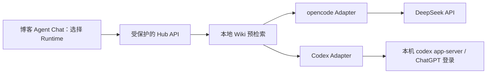
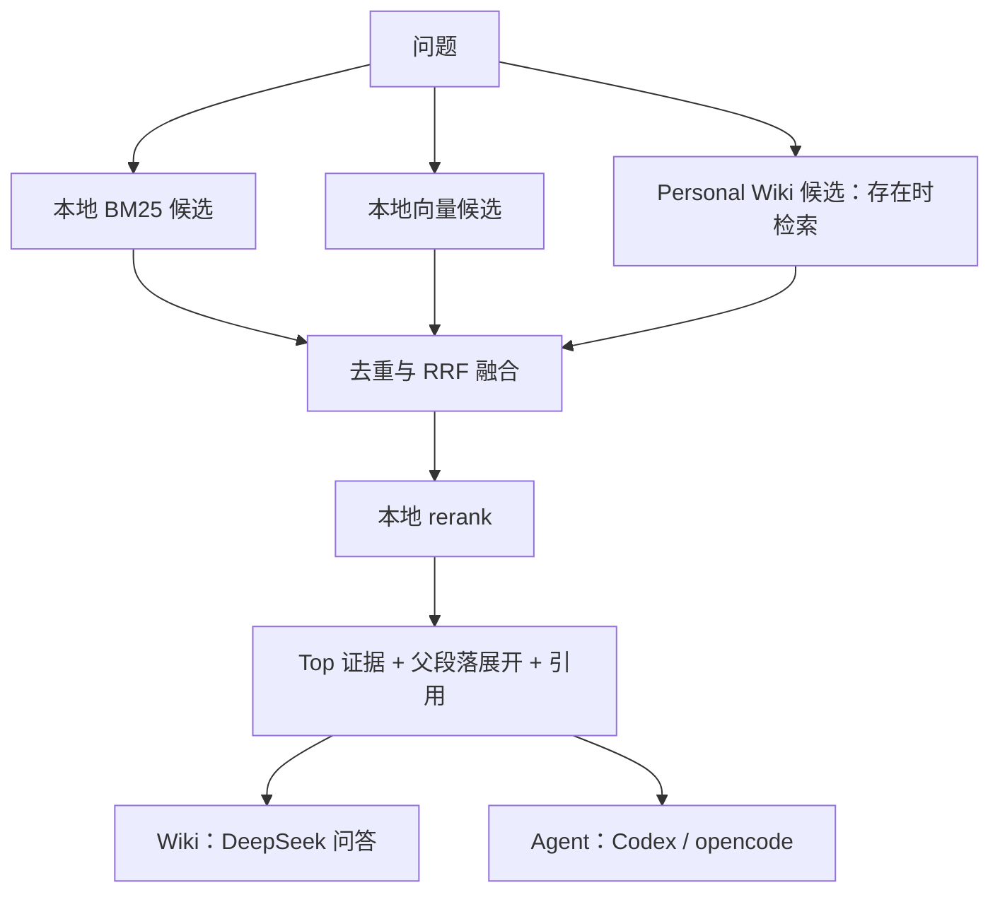

# Personal AI Hub V1 改进与实施计划

**日期：** 2026-10-22（Asia/Shanghai）\
**状态：** 2026-10-23 V1 本地实现、GPU 推理、新索引与检索评估完成；尚未部署博客，公网与真实 Agent 任务由用户手动启动后验收。\
**目标：** 让博客可靠访问本地 Wiki；Agent Chat 首版支持 opencode / Codex 独立会话二选一；检索、向量化、重排与文档解析均在本地执行，DeepSeek 问答继续使用系统环境变量 DEEPSEEK。\
**架构：** 保持 `E:\blog` 承担管理员页面、认证、代理和 MCP，`E:\wiki` 承担知识库、模型调用和 Agent 执行。Cloudflare Tunnel 继续转发本地 FastAPI。\
**技术栈：** TanStack Start / React / Zod / Vitest，FastAPI / Pytest / SQLite，cloudflared，opencode 1.14.19。\
**执行方式：** 在现有目录执行 SDD/TDD，保留用户已有改动。第 1–9 节保留原审查与规格基线；当前实现状态以第 10 节及阶段文档的 2026-10-23 记录为准。

**本次用户确认后的版本范围：** Codex 纳入 V1，与 opencode 并存；只管理 Hub 独立会话，不同步或接管原有桌面聊天；DeepSeek Harness 暂停。下文旧模型名只作为源码审查基线，目标 API 模型名以第 9 节的最新核验为准。

## 2026-10-23 审查修复验收约束

本次按 `personal-ai-hub-v1-code-review-2026-10-23.md` 的 16 项问题修复，输入与现有两个 Runtime/Wiki 入口保持一致。

- 缓存仅按原始问题的完整字节和配置指纹精确匹配；旧格式不复用。相似词不能直接返回答案或注入历史答案，未获正反馈的记录不复用。
- 个人知识以唯一页面 ID 命名，禁止覆盖同名页面；页面、变更集和审计元数据在同一事务提交。确认后的界面需明确返回索引更新结果，重建失败说明已保存但索引待更新，保持当前 generation。
- 引用行号必须对应引用路径的文本；普通文档从 Markdown 正文定位，摘要/个人页计入 frontmatter 偏移。空白 PDF 页保留页码，图片或绘图扫描页显式要求本地 OCR。
- 博客代理拒绝重定向；会话响应必须有非空字符串 ID。切换/新建会话清除旧结果，创建与发送互斥，刷新同时更新当前消息。
- opencode 状态检查同时验证健康接口与会话状态；状态、会话操作使用短于代理的总预算。两个 Runtime 每个协议收发/返回都检查墙钟截止时间，超时不自动重发或宣称工具已取消。
- 发送后读断连/协议中断记为 unknown；发送前明确失败记为 failed。Codex 在首次 turn 提交前保存 native_id 与 pending 状态；确认丢失后先读原生历史核验，无法确认时阻止再次发送，禁止另建任务。
- 异常边界不得向 Uvicorn 重抛含私密消息的原始异常；已知错误注册类型处理，意外错误记录不含异常值/源码行/局部变量的堆栈与 request ID。
- 状态诊断与 Codex 启动只要求各自必需配置，DeepSeek key 仅由依赖它的能力校验；不从其它环境来源自动补齐。
- 验收：先以现有公共接口的隔离失败测试复现，再实现并运行相关与全量测试、博客类型检查/构建；保持管理员认证、MCP 错误契约、Codex 只读和真实数据边界。真实模型、Tunnel 与线上部署留待用户启动后验收，不在本轮自动执行。

## 1. 产品范围与本次事实

### 1.1 两个功能分别做什么

| 模块 | 输入 | 处理 | 输出与落盘 |
|---|---|---|---|
| LLM Wiki | 文档、网页、个人沉淀、知识问题 | 本地保存与索引；检索证据；选择本地抽取或大模型 RAG 问答 | 回答、引用、证据、耗时和缓存信息，数据留在 `E:\wiki` |
| Agent Chat | 用户任务、会话、执行模型 | 先查 Wiki，再向本地 Agent Runtime 注入问题与证据，使用它的工具执行任务 | 回答、执行状态、工具结果、引用、运行记录，数据留在 `E:\wiki` |

LLM Wiki 的大模型问答和 Agent Chat 的工具执行是两个入口。Agent 可以通过文件、命令及已配置的工具处理本地任务；桌面点击等 GUI 能力需要对应工具，不能仅凭“安装了 Agent”认定已经具备。

### 1.2 历史问题与当前状态必须分开

- 用户确认的历史事实：曾在手机热点下打通后端与 Tunnel；校园网下不通；也曾出现底层链路已通而博客页面仍报错。
- 用户截图中的中文提示来自博客代理统一错误分支，不能从该提示反推出当时的具体 HTTP 状态或根因。
- 本轮同一聊天中实测：现有 cloudflared 服务自动启动、保持 4 条健康连接，实际路由为 `hub-api.libresensing.com → http://127.0.0.1:8000`；FastAPI 8000 和 opencode 4096 没有监听，公网 `/health` 返回 502。
- 当前服务未启动只能解释当前故障，不能解释全部历史报错。
- 当前存在启用的 TUN 网卡。尚未执行“热点/校园网 × TUN 开/关”的对照实验，也未擅自切换用户网络。
- Tunnel 健康与源站可达是不同检查项；Cloudflare 对连接器未连接和源站不可达分别提供诊断说明。[Cloudflare 官方故障分层](https://developers.cloudflare.com/tunnel/troubleshooting/)

### 1.3 源码与运行环境基线

- 博客当前提交：`1df7f10`；Hub 主要功能提交于 2026-06-02 至 2026-06-03。
- 本机知识库元数据：21 个 sources、21 个 summaries、5237 个 chunks、68 个 assets、0 个 wiki_pages。
- opencode 本机 npm 包版本为 `1.14.19`。
- 本机已安装并正在运行 DeepSeek Harness 桌面版 `0.2.1-rc.2`，更新通道为 nightly；未调用其模型或修改配置。
- 本机 Codex CLI 为 `0.159.2`，帮助信息确认存在 `app-server`、stdio 和非交互执行能力。
- `E:\blog\.mcp.json` 与 `E:\blog\.codex\config.toml` 已配置博客 `https://libresensing.com/mcp`。配置存在不等于当前客户端已完成 OAuth、scope 和 Wiki 工具调用验收。

## 2. 检查结果

“已复现”表示使用隔离临时目录和替身完成验证；“源码确认”表示已定位实现与契约差异；“风险”仍需针对性复现，不能写成已发生事故。

| 编号 | 优先级 / 状态 | 问题、证据与影响 | V1 处理 |
|---|---|---|---|
| HUB-01 | P0 / 源码确认 | `E:\blog\src\features\personal-ai-hub\service\personal-ai-hub.service.ts:141` 将所有非 2xx 响应变成截图中的同一句错误。401、422、502、503 无法区分 | 返回可序列化的错误原因、层级、上游状态和 request ID；不返回原始敏感响应 |
| HUB-02 | P0 / 契约确认 | `E:\wiki\personal_wiki_brain\agent\opencode_runtime.py:94` 发送字符串 model，但已安装版本的官方 `SessionPromptData` 要求对象；当前测试还断言错误字符串 | 按 1.14.19 官方契约修正请求和测试；随后人工验证真实消息 |
| HUB-03 | P1 / 源码确认 | `E:\blog\src\routes\admin\personal-ai-hub\agent-chat.tsx:37` 等查询未渲染错误，`:177` 在数据缺失时显示 `{}`、`[]` | 明确区分加载、成功但为空、请求失败；展示状态和会话查询错误 |
| HUB-04 | P1 / 已复现 | `E:\wiki\personal_wiki_brain\chat\service.py:59` 和 `chat\cache.py:45` 只用问题命中缓存。切换模型、检索模式、topK 后仍返回旧答案和旧执行参数 | 缓存键包含回答配置、检索配置和知识版本；Agent 预检索与 Wiki 回答隔离 |
| HUB-05 | P1 / 已复现 | `api\server.py:82` 只检查索引目录存在并固定返回 ready。空临时库没有任何 BM25 文件，仍报告 ready；`retrieval\indexing.py:126、163` 对缺失文件返回空结果 | 检查所选检索模式需要的实际文件；区分空库、未建索引、损坏索引和无命中 |
| HUB-06 | P1 / 已复现 | 缺少 `OPENCODE_SERVER_URL` 时 `GET /agent/status` 返回纯文本 500；运行时、模型和索引异常没有统一错误映射 | 后端输出受控 JSON 错误；意外异常只暴露 request ID |
| HUB-07 | P1 / 源码确认 | Wiki 页面 `index.tsx:38` 写死 `answerMode: local`、`retrievalMode: bm25`。当前网页只做证据抽取，没有模型问答模式选择 | 增加“检索摘录 / 大模型问答”、模型和检索模式选择，并显示本次实际使用配置 |
| HUB-08 | P1 / 源码确认 | `start_hub.ps1:12`、`status_hub.ps1:9` 和 FastAPI 只读进程环境；当前用户级 token 存在而当前进程未继承。启动也未预检模型 key 和 Runtime 配置 | 明确配置来源和缺失项；启动前完成检查；提供不启动进程的校验模式 |
| HUB-09 | P1 / 设计风险 | 代理 fetch 无显式超时；Runtime 为同步 60 秒请求，模型客户端还有更长超时。中断后上游任务可能继续，失败任务缺少运行记录 | 设置可解释的请求预算，记录开始/失败/状态未知；不自动重发执行请求。持久化长任务放下一版 |
| HUB-10 | P1 / 环境复现 | 当前 NumPy 2.4.6、Pandas 1.5.3，与 requirements 的 NumPy 1.26.4 不一致。全量 Pytest 在导入 Gradio/Pandas 时发生 ABI 错误 | 先建立可复现的 wiki 独立 Python 环境，不在全局 Anaconda 上盲目升级或降级 |
| HUB-11 | P2 / 源码风险 | 启停脚本依靠全机命令行子串识别进程，未限定所属项目；Windows 的 `opencode.exe` / `opencode.ps1` 形式也可能漏检 | 按本次启动的 PID、命令和工作目录管理；禁止全机匹配后批量停止 |
| HUB-12 | P2 / 功能与安全边界缺口 | Runtime 默认工作目录为 `E:\wiki`，前端不能选择已授权项目；召回文本未明确标为不可信资料；缺少网页审批交互 | V1 标明实际工作目录、限制为受控短任务；多项目、工具审批和更强执行隔离放下一版 |
| HUB-13 | P2 / 资源风险 | MetadataStore 使用 `with sqlite3.Connection` 但不显式关闭连接；隔离审查结束时曾出现 Windows 临时库文件占用 | 后续补充连接释放验证；按事务与连接生命周期最小修改，不据此推断已有数据损坏 |
| HUB-14 | P1 / 源码及索引确认 | 默认使用 DashScope text-embedding-v4 / 1024 维；现有索引 manifest 亦为该模型。不符合用户新的本地检索要求 | 新建本地模型与索引 generation，禁止继续调用云 embedding/rerank |
| HUB-15 | P1 / 源码与键碰撞确认 | embedding 缓存未区分 query/document；空白归一化令缩进语义不同的代码产生相同 text_hash | 按实际输入字节、角色、模型修订和 instruction 分离缓存 |
| HUB-16 | P1 / 数据与源码确认 | 4176 个网页 chunk 平均约 11 字符，3628 个不足 20 字符；抓取器把整个 body 的文本节点逐项转为段落 | 正文提取、去导航、按标题与 token 预算合并分块；保留原始 HTML |
| HUB-17 | P1 / 数据与源码确认 | 22 个项目 chunk 超过 6000 字符，最长 11832；向量化只取前 6000 字符，尾部失去表示 | 结构与 token 感知的子块，保留父块和行号，不静默截掉尾部 |
| HUB-18 | P1 / 设计风险 | 摘要仅取首块/前五块，而命中摘要决定后续 chunk 的 source 过滤范围 | 全局 chunk 召回独立执行，摘要用于补充和展开，不作为唯一硬门控 |
| HUB-19 | P2 / 设计风险 | BM25/向量在各组内分别归一化后混排，跨来源与层级的分数不一定可比 | 用同一候选池的名次融合与本地重排，以实际标注集验证 |
| HUB-20 | P1 / 源码确认 | PDF/旧格式导入默认走 MinerU 云端 API，而用户要求除大模型外本地处理 | 默认本地 PDF 解析；无 OCR 配置的扫描件显式报错，不再请求 MinerU 云端 |
| HUB-21 | P2 / 源码确认 | 中文 BM25 按单字切分，CamelCase 标识符未拆词 | 补充技术词/中文词组及代码标识符处理，随索引 generation 重建并评测 |
| HUB-22 | P1 / 源码确认 | 重排缓存只包含候选 ID，不含证据文本 hash、模型修订和知识版本 | 同 ID 内容更新后必须重新计算，禁止返回旧证据 payload |

HUB-02 的依据是与本机版本一致的官方生成类型，非仅依据最新文档推测：[opencode v1.14.19 请求契约](https://github.com/anomalyco/opencode/blob/v1.14.19/packages/sdk/js/src/gen/types.gen.ts)。该版本要求：

```json
{
  "model": {
    "providerID": "deepseek-direct",
    "modelID": "deepseek-flash"
  }
}
```

## 3. V1 的交付边界

### 3.1 本版完成

1. 修复代理错误丢失、后端普通 500、Agent 初始查询错误不可见。
2. 修复 opencode 1.14.19 消息请求契约，正确展示文本回答与引用；原始调试 JSON 可折叠查看。
3. Wiki 页面支持现有后端已具备的单轮 RAG 问答和检索选择。
4. 修复缓存配置混用，所选索引缺失时明确报错。
5. 统一手动启动前校验与状态检查，使用户能分别判断 FastAPI、知识库、opencode、Tunnel 和博客代理。
6. 完成离线自动测试，再由用户手动启动后端，进行真实链路验收。
7. 首版 Agent Chat 增加 Codex / opencode 选择；两者模型配置、会话、执行结果与计费来源分开。
8. 使用本地开源 embedding / reranker，修复网页正文与长代码分块，离线重建并验证新索引。
9. DeepSeek 默认改为 `deepseek-flash`，保留当前账号清单中的 `deepseek-v4-pro` 为显式选项；只读取系统变量 `DEEPSEEK`。
10. PDF 默认改成本地解析，关闭既有云向量、云重排、Qwen 问答和 MinerU 云端处理入口。

### 3.2 本版限制与后续功能

- opencode 保留；Codex 在同一首版内增量接入，各自独立验收。用户选择哪种 Runtime 就执行哪种，失败时不切换。
- Wiki 本版是单轮带引用问答；持久化多轮 Wiki 会话属于后续功能，页面不得宣称已支持跨轮追问。
- 首次 Agent 验收使用短、可观察的任务。分钟级任务需要异步提交、持久化状态、查询与取消机制，不能以增加 HTTP 超时替代。
- 本轮不安装开机自启动服务，后端由用户手动启动；自启动作为链路通过后的运维工作。
- 原始资料和个人知识不迁出 `E:\wiki`；派生索引可新建 generation，保留旧索引与缓存，不执行破坏性覆盖；不改网络/TUN或两个项目的 AGENTS.md。
- 不让浏览器持有 Hub token，不公开 Runtime 原始端口，不默认授予整个磁盘操作权限。

## 4. V1 API 与错误规格

### 4.1 保持的接口

- FastAPI：保留 `/health`、`/kb/status`、`/kb/sources`、`/kb/query`、`/kb/feedback` 及现有 `/agent/*` 路径。
- 请求：继续由博客服务端注入 `X-Hub-Token`；请求 ID 使用 `X-Hub-Request-Id`。
- 成功：保持 Wiki 和 Agent 已有成功字段，新增状态字段必须同步更新 Zod、页面及 MCP。
- 管理员 Server Function：业务结果采用项目已有的 `Result<T, E>`，通过普通 JSON 对象传递错误，不依赖自定义 Error 的属性跨边界序列化。
- MCP：成功结构保持原样；失败返回 `isError: true`，携带相同的安全错误字段。`personal-ai-hub:read` 权限保持不变。
- 认证和权限：继续由 `adminMiddleware` 处理；业务错误不能将未登录或无管理员权限转换成成功结果。
- Agent 请求新增必选 `runtime: opencode | codex`；服务端按 Runtime 校验模型。响应新增 `runtime` 和 `runtime_result`，opencode 分支可保留旧 `opencode_result` 作为兼容字段，Codex 分支不伪造该字段。Zod、前端和后端同批更新。
- Codex 使用它本机配置的有效模型或显式选择的 Codex 模型，不把 DeepSeek 的 model ID 传给 Codex；opencode 使用用户选择的 DeepSeek API 模型。
- 问答模型仅支持本版批准的 DeepSeek ID；rerank 仅支持 `off` 和本地重排选项；旧云模型参数显式返回 422，不静默映射或调用。

拟新增的错误类型位于 `E:\blog\src\features\personal-ai-hub\schema\personal-ai-hub.schema.ts`：

```ts
import type { Result } from "@/lib/errors/error";

export type HubErrorReason =
  | "HUB_CONFIG_MISSING"
  | "HUB_URL_INVALID"
  | "HUB_UNAUTHORIZED"
  | "HUB_INVALID_REQUEST"
  | "HUB_NETWORK_ERROR"
  | "HUB_TIMEOUT"
  | "HUB_UPSTREAM_ERROR"
  | "HUB_RESPONSE_INVALID"
  | "KB_INDEX_NOT_READY"
  | "AGENT_RUNTIME_NOT_READY"
  | "AGENT_EXECUTION_UNKNOWN"
  | "MODEL_CONFIG_MISSING"
  | "LOCAL_MODEL_NOT_READY"
  | "INDEX_GENERATION_MISMATCH"
  | "LOCAL_PARSER_NOT_READY"
  | "CODEX_AUTH_UNAVAILABLE"
  | "RUNTIME_SESSION_MISMATCH"
  | "INTERNAL_ERROR";

export type HubError = {
  reason: HubErrorReason;
  layer: "blog_proxy" | "hub" | "retrieval" | "agent_runtime";
  message: string;
  requestId: string;
  upstreamStatus?: number;
};

export type HubResult<T> = Result<T, HubError>;
```

### 4.2 错误行为

| 场景 | FastAPI / 上游行为 | 博客展示 |
|---|---|---|
| 博客 URL 或 token 缺失、URL 格式错误 | 不发送上游请求 | 明确指出缺少哪个配置项；不显示值 |
| Hub token 错误 | HTTP 401 | Hub 鉴权失败，与博客登录失效分开 |
| 参数不合法 | HTTP 422 | 展示安全的字段位置和原因，不返回输入值 |
| Tunnel 回源失败或非 JSON 错误页 | 保留实际 HTTP 状态，如 502 | 上游 HTTP 502 + request ID；不武断标成校园网或 token 错误 |
| 网络失败 | 代理返回 HUB_NETWORK_ERROR | 请求未完成，不伪造“知识库无命中” |
| 索引缺失或损坏 | HTTP 503 / KB_INDEX_NOT_READY | 指出检索模式和缺少的索引组，不切换为别的检索模式 |
| opencode 未配置或离线 | HTTP 503 / AGENT_RUNTIME_NOT_READY | Runtime 未就绪，不影响独立 Wiki 查询 |
| 模型 key / provider 缺失 | HTTP 503 / MODEL_CONFIG_MISSING | 显示缺失配置名；不切模型 |
| Runtime 超时 | HTTP 504 / HUB_TIMEOUT | 任务可能仍在执行，先刷新会话，不自动重发 |
| 发送后断连或确认丢失 | HTTP 503 / AGENT_EXECUTION_UNKNOWN | 执行结果未知，先刷新原会话核验，禁止自动重发 |
| HTTP 200 但响应结构错误 | HUB_RESPONSE_INVALID | 协议不匹配，不作为正常回答展示 |
| 意外内部异常 | HTTP 500 / INTERNAL_ERROR | 仅安全提示和 request ID，详细原因留在本地日志 |

FastAPI 的失败响应使用 `{"error": HubError}`；博客服务将其转为 `{data: null, error}`。规范 HubError 校验后保留来源层级；没有规范错误体的 401/422 由代理分别映射为 HUB_UNAUTHORIZED/HUB_INVALID_REQUEST，层级为 blog_proxy。其它非 JSON 错误响应保留真实 HTTP 状态并生成 HUB_UPSTREAM_ERROR，不解析或展示任意 HTML。敏感信息不能进入前端、MCP、控制台或日志。

请求预算初值：状态检查 5 秒、会话读取 10 秒、Wiki 问答 45 秒、Agent 短任务 75 秒。底层模型与检索 HTTP 客户端按剩余预算执行；客户端超时不能声称已经取消本地工具。禁止自动重发创建会话、发送任务等有副作用请求。

### 4.3 就绪与缓存

- `/health` 仅表示 Hub 进程和鉴权链路可用，不表示所有模型和 Runtime 可用。
- `/kb/status` 返回数据数量和每种检索模式的实际可用性。空库返回 empty；有数据但索引文件缺失返回 not_ready。
- 0 个 Personal Wiki 页面是合法空数据，不要求为该空组构建非空索引；有来源的 summary/chunk 组必须满足所选模式的文件契约。
- Agent 状态按 Runtime 分别检查 opencode HTTP 健康，或 Codex stdio 协议初始化与认证就绪；会话忙碌状态单独展示。opencode 空的 `/session/status` 不能单独证明 Runtime 就绪。
- 缓存指纹包括用途（Wiki 回答 / Agent 召回）、answerMode、provider/model、retrievalMode、searchScope、topK、bm25TopK、vectorTopK、bm25Weight、rerankMode、rerankTopK 和知识版本。各入口使用统一的规范化默认值后再计算指纹。
- 知识版本由 source 的内容 hash/状态、Wiki 页面更新时间/状态、当前检索索引文件指纹共同生成；索引文件校验与缓存使用同一份文件清单。
- 精确与语义缓存均限定在相同指纹内。旧记录缺少指纹时不复用，保留文件，不执行清理或静默迁移。
- Agent 预检索不能因 Wiki 的答案缓存直接返回旧召回而绕过当前检索参数。

## 5. 实施顺序与文件范围

### 任务 0：恢复可复现的 Python 测试环境

**范围：** `E:\wiki\requirements.txt`、拟新增 `E:\wiki\requirements.lock.txt`、`E:\wiki\scripts\start_hub.ps1`。依赖锁只记录实际验证过的版本。

- [ ] 记录当前导入失败：NumPy 2.4.6 / Pandas 1.5.3，requirements 指定 NumPy 1.26.4。
- [ ] 在 `E:\wiki\.venv` 建立独立环境，按项目 requirements 安装并验证依赖，不修改全局 Anaconda。
- [ ] 完成后才生成实际解析环境的锁定列表，并检查不包含本机私密路径。
- [ ] 启动脚本使用明确的项目解释器，缺少解释器时报错，不自动改用其它 Python。
- [ ] 运行全量 Pytest，确认 Gradio 相关模块可收集。环境失败与业务测试失败分别记录。

拟执行命令：

```powershell
& D:\anaconda\python.exe -m venv E:\wiki\.venv
& E:\wiki\.venv\Scripts\python.exe -m pip install -r E:\wiki\requirements.txt
Set-Location E:\wiki
& E:\wiki\.venv\Scripts\python.exe -m pytest -q
```

### 任务 1：先修 opencode 消息契约与 Runtime 错误

**修改：** `E:\wiki\personal_wiki_brain\agent\opencode_runtime.py`、`E:\wiki\personal_wiki_brain\api\server.py`、`E:\wiki\personal_wiki_brain\agent\chat_store.py`。\
**测试：** `E:\wiki\tests\test_opencode_runtime.py`、`E:\wiki\tests\test_fastapi_hub_api.py`。

- [ ] RED：将现有请求断言改成官方对象格式，运行单测并确认失败。
- [ ] GREEN：保留现有 provider 与映射结构，将 HTTP 请求的 model 改为下列对象；业务模型名按第 9.5 节同步更新。
- [ ] RED/GREEN：用 MockTransport 分别模拟连接拒绝、超时、HTTP 400 和 HTTP 200 但 `info.error` 存在。失败不能写成 completed。
- [ ] 为 Runtime 请求显式释放自建 HTTP client；注入的 client 由调用方管理。
- [ ] 对 session ID 使用 URL path 编码，校验空白值；模型配置不合法时在发请求前报错。
- [ ] 在执行前生成 run ID，记录开始、成功、失败或结果未知。失败记录不丢失召回和安全错误信息，不自动重发。

目标请求片段：

```python
payload = {
    "agent": self.config.agent,
    "model": {
        "providerID": OPENCODE_DIRECT_DEEPSEEK_PROVIDER,
        "modelID": resolved_model,
    },
    "parts": [{"type": "text", "text": prompt}],
}
```

最小契约断言：

```python
assert payload["model"] == {
    "providerID": "deepseek-direct",
    "modelID": "deepseek-flash",
}
```

### 任务 2：实现后端受控错误、索引就绪检查与缓存隔离

**修改：** `E:\wiki\personal_wiki_brain\api\server.py`、`chat\service.py`、`chat\cache.py`、`retrieval\indexing.py`。请求预算还涉及 `E:\wiki\personal_wiki_brain\llm\deepseek.py`、Runtime Adapter 与本地模型调用；既有云 Qwen 路径由任务 2A 停用，不再扩展。\
**新增小模块：** `E:\wiki\personal_wiki_brain\api\errors.py` 负责安全错误映射；`E:\wiki\personal_wiki_brain\retrieval\readiness.py` 负责文件契约和知识指纹。\
**测试：** 现有 `test_fastapi_hub_api.py`、`test_query_cache_and_tuning.py`、`test_vector_bm25_retrieval.py`。

- [ ] RED：空临时库不得报告 ready；有来源但缺 BM25/vector 文件必须报 KB_INDEX_NOT_READY；0 页 Wiki 不误报索引损坏。
- [ ] GREEN：按所选模式检查实际文件，并区分 empty / ready / not_ready；查询禁止把缺索引当作零命中。
- [ ] RED：同一个问题切换回答模型、answerMode、retrievalMode、topK、rerank 或知识版本，必须重新执行对应步骤。
- [ ] GREEN：增加配置与知识指纹，精确和语义缓存同时检查；保留旧缓存文件。
- [ ] RED/GREEN：Wiki 回答缓存不能代替 Agent 本次知识预检索；对无召回保留明确空结果，不编造证据。
- [ ] RED/GREEN：query/document 缓存隔离；代码换行和缩进变化改变键；同候选 ID 的文本或模型修订变化使重排缓存失效。
- [ ] RED/GREEN：token 错误为 401、非法参数为 422、缺 Runtime 为结构化 503、超时为 504；响应和日志均不含测试密钥。
- [ ] RED/GREEN：使用替身验证剩余预算传给 DeepSeek HTTP 客户端、Runtime Adapter 和本地检索阶段；执行前或阶段结束时检查期限，内部重试不能越过总预算。本地计算未停止时不得声称已取消，不通过真实网络等待超时来测试。
- [ ] 检查 SQLite 连接是否显式释放；若增加释放修复，先用隔离库完成行为测试。

缓存指纹的编码约束：

```python
import hashlib
import json

def cache_fingerprint(context: dict) -> str:
    encoded = json.dumps(
        context, ensure_ascii=False, sort_keys=True, separators=(",", ":")
    ).encode("utf-8")
    return hashlib.sha256(encoded).hexdigest()
```

context 必须包含本节规定的完整字段，不能只传问题或模型名。测试同时验证字段变化和同配置命中，避免只测试 hash 函数自身。

### 任务 3：打通博客代理、Server Function 和 MCP 的错误契约

**修改：**

- `E:\blog\src\features\personal-ai-hub\schema\personal-ai-hub.schema.ts`
- `E:\blog\src\features\personal-ai-hub\service\personal-ai-hub.service.ts`
- `E:\blog\src\features\personal-ai-hub\api\personal-ai-hub.admin.api.ts`
- `E:\blog\src\features\mcp\features\personal-ai-hub\tools\wiki-query.tool.ts`
- `E:\blog\src\features\mcp\features\personal-ai-hub\tools\wiki-status.tool.ts`
- `E:\blog\src\features\mcp\features\personal-ai-hub\tools\wiki-sources-list.tool.ts`

**测试：** 现有 `personal-ai-hub.service.test.ts`、`personal-ai-hub.mcp.test.ts`、`src\lib\env\server.env.test.ts`。

- [ ] RED：401、422、502 文本、503 JSON、网络拒绝、超时、HTTP 200 结构错误必须产生不同且可诊断的 Result。
- [ ] RED：错误信息中包含测试 token 或 HTML 时，浏览器/MCP 输出和日志都不得包含它们。
- [ ] GREEN：校验 URL，生成 request ID，注入鉴权并设置期限，转换为第 4 节定义的安全 Result。
- [ ] GREEN：管理员函数传递 Result；MCP 对失败明确返回 isError，成功输出保持兼容。
- [ ] 验证管理员权限仍生效，未登录或非管理员请求不会触发上游 fetch。
- [ ] 检查生产 Workers 中 URL 和 token 是否都配置。仓库配置与 CI 读取逻辑不能代替实际生产环境验收。

上游返回无规范业务错误体的 HTTP 401 时，预期结果为：

```ts
expect(result.error).toMatchObject({
  reason: "HUB_UNAUTHORIZED",
  layer: "blog_proxy",
  upstreamStatus: 401,
});
expect(result.data).toBeNull();
```

### 任务 4：整理两个页面的真实状态和回答展示

**修改：** `E:\blog\src\routes\admin\personal-ai-hub\index.tsx`、`agent-chat.tsx`。\
**拟新增：** `E:\blog\src\features\personal-ai-hub\components\hub-error.tsx` 和 `hub-query-options.tsx`，只复用本功能内实际需要的 UI。\
**测试：** 优先在现有 Node 测试模式下测试参数和状态转换；涉及用户交互时增加一个对应组件用例，不为纯文案建立快照。

- [ ] Wiki 增加回答模式、模型和检索模式选择；提交真实选择的参数，默认模式在界面明确显示。
- [ ] Agent 增加 Runtime 选择；模型列表、会话列表、结果展示和计费说明随 Runtime 更新，切换时不沿用另一 Runtime 的 session ID。
- [ ] Wiki 回答、引用与当前配置分区显示；新请求失败时清除成功状态，旧回答若保留必须明确标为历史结果。
- [ ] Agent 的 status/sessions/messages 分别显示加载、空数据、成功和失败；不以空 JSON 代替错误。
- [ ] Agent 按 Runtime 的 text parts 渲染回答，引用与原始 JSON 分开展示；`info.error` 不渲染为成功答案。
- [ ] 发送按钮在请求期间禁止重复提交；连接失败或超时不自动重发任务。
- [ ] 页头及模块卡片注明代码接入状态与当前在线状态的区别，删除“下一阶段接入 opencode”的过期文案。
- [ ] 用户界面不展示 token、配置文件内部结构或无助于决策的实现细节；诊断信息可折叠。

### 任务 5：统一手动启动与分层检查

**修改：** `E:\wiki\scripts\start_hub.ps1`、`status_hub.ps1`、`stop_hub.ps1`。\
**测试：** `E:\wiki\tests\test_hub_scripts.py`。

- [ ] RED/GREEN：增加 `-ValidateOnly`，只校验并输出解释器、配置名和拟启动内容，不启动服务、不输出凭证。
- [ ] 启动脚本提供显式 `-EnvSource Process|User|Machine`，本机手动启动选择 User；只从指定系统环境来源加载本次所需配置并注入子进程。DEEPSEEK 不从 .env、前端或请求体读取。缺失时立即报错，不自动遍历其它来源，不填默认 token 或切换服务。
- [ ] 校验 `LOCAL_HUB_API_TOKEN`；选择 opencode 时同时校验模型 key、OPENCODE_CONFIG 文件和 Runtime 地址。
- [ ] 选择 opencode 时先启动并确认 Runtime 健康，再启动 FastAPI；只管理本次创建的进程。
- [ ] 状态脚本分别检查本机 Hub、索引模式、所选 Runtime 就绪状态和公网 Hub。opencode 检查 HTTP 健康；Codex 检查协议与认证，不假定存在 HTTP 端口。公网 401、502、超时不得统一写成 FastAPI offline。
- [ ] cloudflared 指标服务仅作本机诊断；没有诊断端点时明确标为未检查，不把它当作业务在线或离线结论。
- [ ] 停止脚本只能停止核验后的本项目 PID；不按全机子串批量终止 opencode。

### 任务 5A：Codex 独立会话与双 Runtime 选择

**新增：** `E:\wiki\personal_wiki_brain\agent\codex_runtime.py`、`runtime_registry.py`、`hub_session_store.py`。\
**修改：** `E:\wiki\personal_wiki_brain\api\server.py`、`agent\chat_store.py`、博客 Hub schema / service / admin API / Agent Chat 页面。\
**拟新增测试：** `E:\wiki\tests\test_codex_runtime.py` 验证协议与受管会话；现有 FastAPI 和博客服务测试覆盖 Runtime 分派。

- [ ] RED：同一个用户任务分别选 opencode / codex，必须只调用对应 Adapter；错误不切换 Runtime。
- [ ] GREEN：两个 Adapter 实现一致的健康、会话创建、消息、执行结果接口；会话映射带 runtime，跨 Runtime 使用 session ID 返回明确错误。
- [ ] RED/GREEN：Codex 完成 initialize / initialized、thread/start、turn/start 后才能执行；收集流式消息，failed / interrupted 不能报告成功。
- [ ] RED/GREEN：只列出 Hub 自己创建的 Codex 会话；不加载、恢复或修改用户原有桌面聊天。
- [ ] 本机配置显式指定 `HUB_CODEX_HOME=D:\AIData\Codex`，只传给 Codex 子进程；使用该目录现有登录，不复制 auth.json，不更改系统或桌面的 CODEX_HOME。
- [ ] V1 Codex 以只读项目任务验收，工作目录显式配置为目标项目。需要写入或额外审批但网页尚不支持的操作必须明确拒绝，不关闭沙箱来执行。
- [ ] 用替身子进程/协议消息完成离线测试，不启动真实 Codex 推理，不消耗账号额度。
- [ ] 原生 Codex 历史由它自己保存；Hub 会话映射、用户可见历史、召回和运行记录写入 `E:\wiki\data`。

本任务在链路基础修复后、任务 6 的全量验证前完成；先后完成是 V1 的增量交付，不代表将 Codex 推迟到下一版。

### 任务 6：离线验证和文档同步

- [ ] 每项实现先验证对应 RED，再验证 GREEN；补充的测试不得调用真实付费模型、Tunnel 或 opencode 服务。
- [ ] 运行相关 Node/Pytest；跨代理、MCP 和 API 的改动完成后运行全量检查。
- [ ] 使用临时目录，不写入实际 `E:\wiki\data`；本机服务和真实模型验收在下一节单独执行。
- [ ] 更新 completed / in-progress / known-issues / roadmap；保留每项修复的证据与未完成项。
- [ ] 检查 git diff，只提交明确属于本次功能的代码；不得顺带提交已有未提交文件和私密配置。

```powershell
Set-Location E:\blog
bun run test:node src/features/personal-ai-hub src/features/mcp/features/personal-ai-hub src/lib/env/server.env.test.ts
bun run test:node
bun typecheck
bun run test

Set-Location E:\wiki
& E:\wiki\.venv\Scripts\python.exe -m pytest -q
```

Workers 测试依赖本地 wrangler.jsonc；本轮该文件已存在，但尚未运行 Workers 集成测试。若运行失败，应记录实际原因，不能继续沿用“文件一定缺失”的旧描述。

## 6. 用户手动启动后的验收

### 6.1 验收顺序

1. 本地 `/health` 带 token 为 200；不带 token 为 401。
2. 本地 `/kb/status` 正确报告数据与可用模式；执行一次 BM25 + local 查询，验证引用，不调用付费模型。
3. 本地 opencode `/global/health` 为 200，Hub `/agent/opencode/health` 为 200。
4. 公网 `https://hub-api.libresensing.com/health` 使用相同 token 为 200；随后验证公网 `/kb/status`。
5. 管理员登录博客后点击 Check；再用相同问题、相同参数执行 Wiki 查询。
6. 选择大模型问答执行一次受控调用，核对模型、引用和耗时。该步骤会使用真实模型额度。
7. 分别选择 opencode 与 Codex 创建 Hub 独立会话，执行“只列出当前工作目录文件名，不修改文件”的短任务，核对召回、实际目录、回答与运行记录。opencode 消耗 DeepSeek API，Codex 消耗其登录账号的额度。
8. 在 Codex 中调用 `wiki_status`、`wiki_sources_list`，以及 `answerMode=local`、`retrievalMode=bm25` 的 `wiki_query`。

本轮没有执行第 6、7 步，也没有代表用户启动后端。

手动检查示例，先显式读取用户级 token，不回显：

```powershell
$hubToken = [Environment]::GetEnvironmentVariable("LOCAL_HUB_API_TOKEN", "User")
if ([string]::IsNullOrWhiteSpace($hubToken)) {
    throw "用户环境变量 LOCAL_HUB_API_TOKEN 未配置"
}
$hubHeaders = @{ "X-Hub-Token" = $hubToken }
Invoke-RestMethod -Uri "http://127.0.0.1:8000/health" -Headers $hubHeaders -TimeoutSec 5
Invoke-RestMethod -Uri "https://hub-api.libresensing.com/health" -Headers $hubHeaders -TimeoutSec 10
Invoke-RestMethod -Uri "https://hub-api.libresensing.com/kb/status" -Headers $hubHeaders -TimeoutSec 10
```

### 6.2 定位“公网能通、博客不能通”

| 对照结果 | 下一步 |
|---|---|
| 本地失败 | 先检查 Hub、索引、模型或 Runtime，不从校园网开始推断 |
| 本地成功，公网失败 | 检查 Tunnel 路由、连接、DNS、网络出口与 TUN 状态 |
| 公网健康成功，公网知识查询失败 | 检查该接口参数、索引和响应，不把健康检查成功当作功能验收 |
| 同参数公网成功，博客失败 | 检查生产 Hub URL/token、管理员 session、Server Function、响应 Zod 校验与代理日志 |
| 博客 Wiki 成功，Agent 失败 | 检查 Runtime 健康、消息协议、provider/model、执行目录和超时 |
| 浏览器博客成功，Codex MCP 失败 | 检查 MCP OAuth、personal-ai-hub:read scope、配置作用域和工具错误结果 |

每次对照保留时间、网络类型、TUN 状态、接口、HTTP 状态、耗时、request ID 和安全错误原因。禁止记录 token/key。热点与校园网使用相同版本、参数和凭证配置；不把其中一条路径成功当作其它路径也已通过。

## 7. 用户已确认：opencode / Codex 并存，Harness 暂停

### 7.1 首版 Runtime 范围

| 选项 | V1 行为 | 模型与费用来源 |
|---|---|---|
| opencode | 保留，修复协议后可选 | DeepSeek API；本机系统变量 `DEEPSEEK` |
| Codex | 新增 Hub 独立会话，可选；不接管已有桌面聊天 | 复用指定 Codex Home 中的 ChatGPT 登录与模型配置 |
| DeepSeek Harness | 暂停，不实现、不增加 UI 选项或新依赖 | 不调用 |

Runtime 失败时报错，不将 Codex 任务转交 opencode，也不将其 DeepSeek model ID 传给 Codex。共同步骤是本地知识预检索，不要求两个执行器共用模型。

### 7.2 Codex 额度如何消耗

- 只读核验显示两套本机 Codex 登录配置都是 ChatGPT 登录模式，保存的账号标识相同；未输出或复制凭证。
- Hub 使用 `D:\AIData\Codex` 现有登录执行模型任务时，使用对应账号/工作空间的 Codex 额度，与该账号日常使用共用，不会因建立独立会话新增额度。
- 如果未来用户主动切换为 API key 登录，则改按该 API 账号的计费方式；本版不新增 OpenAI API key、不自动切换认证方式。
- 实际消耗取决于所选模型、上下文、文件与工具输出及任务轮数，不是固定“一次网页提问扣一次”。剩余额度应看官方 usage 页面或 CLI /status，不根据本机 token 文件猜测。
- 列出历史、读取本地记录、检索本地向量不发起模型推理；实际生成与执行 turn 才调用模型。

以上计费方式以 [Codex 认证文档](https://learn.chatgpt.com/docs/auth) 和 [额度说明](https://learn.chatgpt.com/docs/pricing) 为依据。读取本地保存的登录方式不等于已证明登录仍有效或模型额度充足，首次执行需单独验证。

### 7.3 历史记录放在哪里

| 内容 | 保存位置与策略 |
|---|---|
| Codex 原生会话、事件与状态 | 由 Codex 在显式指定的 `D:\AIData\Codex` 中管理，包含其 sessions 与状态数据库；不手工读写私有数据库格式 |
| Hub 自建会话与 native thread ID 映射 | `E:\wiki\data\modules\agent_chat`，记录 runtime，列表只返回 Hub 创建的会话 |
| Hub 提问、回答、引用、预检索与执行记录 | `E:\wiki\data\modules\agent_chat\conversations.jsonl` 及 `E:\wiki\data\runtime\codex\runs.jsonl`；opencode 使用自己的运行记录分区 |
| 博客 | 通过受保护 API 展示记录，不将完整会话或凭证写入博客仓库、D1 或前端环境变量 |

独立会话表示不接管原有聊天，不代表额外的计费账号。现有 `C:\Users\songm\.codex` 与 `D:\AIData\Codex` 不自动合并；本版也不提供它们的历史同步。Codex 本地状态目录由 CODEX_HOME 决定。[官方配置说明](https://learn.chatgpt.com/docs/config-file/config-advanced)

### 7.4 接入方式



Codex Adapter 通过 stdio 管理本机 app-server，收集执行事件；不公开 Codex 原始端口。后续长任务、写入审批和断线恢复必须补齐后再开放对应操作。[官方 App Server](https://learn.chatgpt.com/docs/app-server)

Codex 主动调用博客 MCP 查 Wiki 是独立方向，继续验证现有三个 Wiki MCP 工具，不需要博客反向打开 Codex 端口。

Wiki 召回是证据，不作为系统指令。Runtime 的工作目录、工具权限与会话归属由 Hub 管理，前端不能提交任意未授权路径。

## 8. 本轮验证记录与交付状态

| 检查 | 结果 |
|---|---|
| 博客 Hub 服务、MCP、env 相关现有测试 | 3 个文件、10 个测试通过 |
| 后端 API、opencode、脚本、检索、环境变量相关现有测试 | 5 个文件、30 个测试通过 |
| 后端全量 `python -m pytest -q --tb=short` | 在 Gradio/Pandas 导入阶段产生 2 个收集错误，未执行全量测试 |
| 缓存配置混用 | 隔离复现：请求模型 B / BM25 / topK=1，返回模型 A / local / topK=8，B 和新检索均未调用 |
| 错误就绪状态 | 隔离复现：没有 BM25 索引文件，仍返回 HTTP 200 / ready |
| Runtime 缺失错误 | 隔离复现：`/agent/status` 返回纯文本 HTTP 500 |
| 真实模型、Agent 执行和完整博客链路 | 未执行，等待后续代码修复与用户手动启动 |
| 本轮文件变更 | 新增本计划；同步既有阶段文档；没有修改业务代码、AGENTS.md 或启动服务 |
| 用户确认范围后的补充检查 | 已核对 Codex 登录模式与账号一致性、硬件、云模型路径、网页分块统计、代码缓存键碰撞 |
| DeepSeek 当前账号模型清单 | 使用 Windows 用户级 DEEPSEEK 仅请求 GET /models，HTTP 200；返回 deepseek-flash / deepseek-v4-pro，没有发起推理 |

隔离复现的三个结果均已输出；该次脚本最终因 Windows 临时 SQLite 文件占用而在清理阶段非零退出，不能将其表述为新增测试全绿。后续单独清理该临时目录的删除操作被自动审批审核拦截，未影响实际知识库。

验收通过后再把对应问题标记为已修复。文档中的待执行事项不能作为已实现能力或线上可用性的证明。

## 9. Wiki 专项审查：本地检索、语料质量与模型更新

### 9.1 现在如何选择模型、何时会调用云端

| 组件 | 当前实现 | 实际调用条件 |
|---|---|---|
| 向量模型 | `retrieval/embedding.py` 默认 DashScope `text-embedding-v4` / 1024 维，使用 DASHSCOPE_API_KEY；现有 manifest 相同 | 重建向量索引，或 vector/hybrid 查询且所需缓存未命中 |
| BM25 | 本地 rank_bm25 | 当前博客页面写死 bm25/local，因此该页面的普通查询没有调用向量或回答模型 |
| 重排 | Qwen 云 rerank 或 LLM rerank，默认 off | 用户在相应入口选择重排时调用；默认 off 不代表这些 API 路径已被移除 |
| Wiki 回答 | 后端默认 Qwen；博客虽传 DeepSeek 名称但 answerMode 为 local | 只有 llm_rag 模式才调用回答模型 |
| Agent 预检索 | 默认 hybrid，经相同 embedding 工厂 | 新问题可能调用云 embedding，随后 opencode 再调用 DeepSeek |
| PDF/旧格式解析 | `ingest/service.py:993` 默认 MinerU 云端 | 导入或重处理相关文档时调用，与是否开始聊天无关 |

用户新的约束覆盖整条流程：不新增云 embedding、云 rerank 或外部文档解析调用；无论某服务是否提供免费额度，默认都改为本地处理。网页资料抓取和下载开源模型属于数据获取，不作为在线推理服务使用。

### 9.2 本地模型选型

本机只读检查：RTX 4060 Laptop 8GB、内存约 64GB。推荐从下列组合开始，不直接上 4B/8B，并以本机质量与显存实测决定是否调整。

| 用途 | V1 推荐 | 配置与理由 |
|---|---|---|
| Embedding | `Qwen/Qwen3-Embedding-0.6B` | 多语言/代码资料，1024 维，查询使用固定检索 instruction，文档单独编码，L2 归一化 |
| Reranker | `BAAI/bge-reranker-v2-m3` | 本地多语言 cross-encoder，重排小规模候选池，避免为每批排序调用付费模型 |
| 词项检索 | 本地 BM25 | 保留函数名、路径、型号等精确匹配能力 |
| 数字 PDF | 本地 PyMuPDF | 提取文字、页码与资产，不把文件上传云解析服务 |
| 扫描件 OCR | 显式配置的本地 OCR，后续按真实扫描件验证 | 没有本地 OCR 时明确拒绝该模式，不转发 MinerU，也不把空文本当导入成功 |

Qwen 官方模型卡列出了 0.6B、1024 维及查询/文档不同编码方法；BGE 官方模型卡提供多语言本地 CrossEncoder 用法。[Qwen 模型卡](https://huggingface.co/Qwen/Qwen3-Embedding-0.6B)、[BGE 模型卡](https://huggingface.co/BAAI/bge-reranker-v2-m3)

2026-10-22 已从官方仓库元数据核对模型修订：

- Qwen3-Embedding-0.6B：`97b0c614be4d77ee51c0cef4e5f07c00f9eb65b3`，Apache-2.0。
- bge-reranker-v2-m3：`953dc6f6f85a1b2dbfca4c34a2796e7dde08d41e`，Apache-2.0。

这是一套适合先验证的工程选择，不是已经证明优于现有系统的基准结论。Qwen 本地开源权重与阿里云 API 为不同运行方式；本版不需要 DASHSCOPE_API_KEY。

模型放在 `E:\wiki\models`，运行依赖放项目独立环境；当前 C 盘约余 3GB，下载和安装不得继续堆到默认 C 盘缓存。模型不提交博客 Git。运行时 `local_files_only=True`，路径或 CUDA 不可用即报错，不自动下载、不切云 API、不自动切 CPU。

初始配置：embedding 使用 cuda:0、FP16、1024 维、max input 2048 tokens、batch 8；rerank 使用 cuda:0、FP16、max pair 2048 tokens、batch 4。以上是待验证的起点；先测实际可用显存和峰值，再调 batch，不承诺未经实测的吞吐或延迟。

### 9.3 先修语料与检索，再评价模型

保留原方案的 Source Library → 摘要 → chunk 证据 → Personal Wiki 思路。当前 Personal Wiki 为 0 页，不能把现状称为已经形成持续维护的个人知识网络，也不急于增加图数据库。

本次量化发现：

- 18 个网页来源生成 4176 个 chunk，平均 11 字符；3628 个不足 20 字符，4027 个不足 50 字符。正文与导航被混合，段落缺少上下文。
- 项目来源有 786 个 chunk，最长 11832 字符；22 个超过现有 embedding 的 6000 字符截断阈值。
- 摘要卡仅截取第一个 chunk 和前五个片段，不能覆盖长文章或整个代码项目。
- small-to-big 当前根据摘要命中的 source 限制 chunk 检索；摘要漏掉主题时，真正证据可能进不了候选集。
- embedding 缓存未区分 query/document，且合并空白；两段具有不同 Python 缩进语义的代码已验证产生同一缓存键。
- rerank 缓存按候选 ID 而非证据内容版本保存，资料更新后有返回旧证据的风险。

V1 改进流程：



RRF 是按名次组合不同检索结果的方法，可避免直接混用各路不同量纲的分数；本项目在本地实现公式，不引入 Elasticsearch 服务。[RRF 算法说明](https://www.elastic.co/docs/reference/elasticsearch/rest-apis/reciprocal-rank-fusion)

初始检索窗口：BM25 30、vector 30，融合后取 20 个候选重排，最终证据 topK 8。Personal Wiki 有数据才加入；相同来源的相邻片段合并/展开，摘要用于补充而不再作为全局 chunk 的唯一硬门控。

网页按配置选择正文提取器，去掉导航/页脚并保留标题层级。chunk 以约 256–768 tokens 为起点，相邻块约 64 tokens 重叠；保留文档标题、节标题、URL/页码/行号和父块映射。短标签与正文合并，代码以结构与行范围切分，禁止只切文本节点或静默截取头部。

查询、文档和代码使用各自明确的编码角色；缓存键包含模型修订、instruction、角色、精确输入 hash、tokenizer/预处理与知识 generation。索引端与查询端必须使用同一个已验证配置。

### 9.4 新索引的安全迁移

- 云模型和本地模型即使同为 1024 维也不在同一向量空间，旧向量不能直接复用。
- 从已保存原始 HTML/文档/项目副本生成新的派生块和索引 generation，不先覆盖旧 chunk、metadata 或向量文件。
- 新的 BM25、向量映射、模型修订、文本/代码预处理、维度、文档数量和校验值写入 manifest；缓存也使用新 namespace。
- 完成数量、维度、归一化、有限数值、向量与 object ID 一一对应及召回验证后，再显式切换活动 generation。
- 切换前后保留旧数据，不自动清理旧缓存；模型/索引不匹配时返回 INDEX_GENERATION_MISMATCH，不读取旧模型向量。
- 有待本地 OCR 的文档标明状态，不让缺内容的文档悄悄算作已完整建库。

### 9.5 DeepSeek 最新型号与系统密钥

2026-10-22 官方模型表及实际账号 `GET /models` 均支持：

| API ID | 当前展示名 / 用途 |
|---|---|
| `deepseek-flash` | 默认；DeepSeek-V4.1-Flash-1017 |
| `deepseek-v4-pro` | 显式可选；官方当前仍列出的 DeepSeek-V4-Pro |

官方模型表明确将旧 `deepseek-v4-flash` 列为兼容名称。新代码与 UI 改用 `deepseek-flash`，旧历史保留原始 requested model，不伪造当时使用的新版本。不要把宣传名直接拼成不存在的 `deepseek-v4.1-flash` 请求 ID。[DeepSeek 官方模型表](https://api-docs.deepseek.com/quick_start/pricing/)

`DEEPSEEK` 只从用户选择的系统环境来源读取并注入本地 Hub/opencode；不写入仓库、博客环境或前端请求。模型失败直接报错，不切换到 Qwen。Codex 仍走它自己的 ChatGPT 登录，这一选项的额度与 DeepSeek API 分开。

必须一起更新：后端 `llm/deepseek.py`、FastAPI 请求 schema、Gradio、opencode model 映射与 `E:\wiki\opencode.json`；博客两个 schema、MCP schema、页面模型列表与对应测试。导入历史中的旧名称不通过全盘替换改写。

### 9.6 补充实施任务与验收

**顺序：** 任务 0 → 1 → 2 → 下列 2A/2B → 3 → 4 → 5/5A → 6。业务 API、前端和 MCP 在同一版本完成契约同步。

**任务 2A：本地模型与模型目录更新**

- [ ] 在现有 `tests/test_vector_bm25_retrieval.py`、`test_deepseek_model.py` 中先验证本地模型选择、最新模型 ID 和 DEEPSEEK 来源；用替身覆盖模型缺失、CUDA 不可用、维度错误、返回数量错误和禁止云调用。
- [ ] 新增 `E:\wiki\personal_wiki_brain\retrieval\local_models.py`，实现本地 embedding 与 reranker；`config/settings.py` 保存路径、修订、设备和批量参数。
- [ ] 修改 `retrieval/embedding.py` 的默认工厂、角色缓存与数量/维度校验；修改 `retrieval/rerank_cache.py` 的内容与模型指纹。
- [ ] 停用 API/Gradio 工厂中的云 embedding/rerank、Qwen 回答与 LLM rerank 入口；过期参数返回 422。
- [ ] 更新 `llm/deepseek.py`、`api/server.py`、`ui/gradio_app.py`、`agent/opencode_runtime.py`、`opencode.json`，以及博客 Hub/MCP schema 和模型选项。
- [ ] 独立环境 requirements 增加实际需要的 torch / transformers / sentence-transformers / 本地解析依赖，验证后锁版本；不安装 Harness。

**任务 2B：正文、分块、融合与新 generation**

- [ ] 先用本地 HTML、长代码、同 ID 更新内容等夹具验证导航剔除、标题/行号保留、长块尾部可召回；不抓真实网络做单测。
- [ ] 修改 `ingest/service.py` 的正文提取与分块、`retrieval/index_objects.py` 的分词和元数据、`retrieval/search.py` 的全局候选与融合、`retrieval/indexing.py` 的 generation/manifest。
- [ ] 修改 `ingest/pdf_parser.py` 和导入工厂为明确的本地解析；本地 OCR 缺失时错误，不调用 MinerU。
- [ ] 建立 20–30 条本地标注检索题，覆盖中文/英文、函数名、文章后半段、长代码尾部和无答案问题，记录目标 source/chunk。
- [ ] 比较原 BM25、清洗后 BM25、本地 hybrid、本地 hybrid+rerank 的 Recall@20、MRR/nDCG、引用定位、P50/P95 耗时与显存。对照过程不调用旧云向量 API。
- [ ] 先确认检索与引用无回归，再由用户手动启动后端进行少量 DeepSeek/Codex 真实回答验收；本轮只查元数据，没有发起模型推理或下载权重。

## 10. 2026-10-23 实现交付与手动验收

第 1–9 节的审查数据和原始待办保留为基线；下面是本次实施后的实际状态。

| 范围 | 当前结果 |
|---|---|
| 环境 | `E:\wiki\.venv`；torch 2.7.1+cu128、NumPy 1.26.4、PyMuPDF 1.27.2.2，107 个依赖通过兼容检查，已保存 `requirements.lock.txt` |
| 博客代理 / MCP | 管理员代理、Result、超时预算、安全错误与 request ID；MCP 返回明确 isError |
| Wiki | DeepSeek 问答/摘录选择、本地检索与重排、引用展示、配置/知识缓存隔离、正文及代码分块修正 |
| Agent | opencode model 对象契约；opencode / Codex 选择；共享 Wiki 检索与可选本地重排；开始/完成/失败/unknown 运行记录 |
| Codex | `D:\AIData\Codex` ChatGPT 登录，Hub 独立会话，stdio 协议，明确工作目录与只读权限；不接管桌面聊天 |
| 启动 | User/Process/Machine 明确来源、ValidateOnly、模型预热、PID 与子进程核验，日志位于 `data/runtime/hub` |
| 原始资料 | 元数据仍为 21 sources / 5237 chunks / 68 assets / 0 wiki pages；原始文件和旧索引保留 |
| 活动索引 | `v1_194a0f098db747b28747e614c212d754`；21 摘要 + 1450 派生 chunk，BM25 / vector / hybrid 均通过内容校验 |
| 验证边界 | 本地代码、隔离测试、GPU 和检索已验证；博客未部署，未发起真实 DeepSeek/Codex/opencode 任务，完整公网链路待人工验收 |

### 10.1 检索评估与调整

标注与原始结果保存在 `E:\wiki\data\evaluations\v1`，最终结果文件为 `results_20261023_013843.json`。24 道题中 22 道有答案、2 道为无答案探针；指标只对 22 道有答案题计算。旧基线使用旧分块、旧分词的全局 BM25，**没有冒称复现原系统全部摘要硬门控行为**。

| 方法 | 目标证据命中前 20 条 | MRR@20 | nDCG@20 | P50 / P95 |
|---|---:|---:|---:|---:|
| 旧分块全局 BM25 | 15/22 | 0.416 | 0.386 | 86 / 131 ms |
| 新分块 BM25 | 22/22 | 0.403 | 0.524 | 122 / 136 ms |
| 本地 hybrid | 21/22 | 0.545 | 0.612 | 176 / 191 ms |
| 本地 hybrid + BGE 重排 | 22/22 | 0.932 | 0.916 | 949 / 1236 ms |

这是人工小样本的工程检查，分块改变了相关对象集合，不能外推为通用模型排名或真实回答正确率。无答案探针仍可能返回低相关候选，尚未做稳定拒答阈值校准。现有 DeepSeek 网页资料是已保存的历史快照，检索不等于获取最新官方信息。

实测后将融合后的重排候选窗口从 20 调整为 60，最终默认证据仍为 8；BGE 输入增加文档标题和章节标题。仅扩大候选池没有解决全部问题，加入标题上下文后，漏掉的递归 JSON schema 证据进入第 2 位。问答阶段在预算内展开相邻父块片段并去重。

向量探针输出 1024 维且归一化；两模型同时加载的探针峰值预留显存约 2252 MiB。最终检索评估复用了已缓存的 query 向量，进程主要加载重排模型，峰值 1264 MiB，不能把该数字当作两模型同时运行的峰值。首次加载曾耗时约 94 秒，因此启动脚本启用预热，最长等待 180 秒，预热完成后才接收网页请求。

### 10.2 验证记录

- 后端：`.venv\Scripts\python -m pytest -q`，136 个测试通过；测试隔离外部网络，不调用付费模型。
- 博客：`bun run test:node --maxWorkers=1 --minWorkers=1`，166 个测试通过；类型检查、Biome 和生产构建通过。
- Workers：`bun run test`，12 个文件、199 个测试通过，退出码 0。构建与测试同时执行曾触发 Paraglide 生成文件竞争，构建结束后独立重跑已通过。运行器仍有旧兼容日期、test 环境 AI binding 和 Windows 临时目录清理警告，均未导致最终测试失败。
- 已用本机 User 来源执行双 Runtime 的 `-ValidateOnly`，仅校验环境与路径，没有启动服务。
- 已对真实资料复核：网页代码恢复 `from openai import OpenAI` 与换行，`verify_docx.py` 引用为第 1–16 行。
- 本地代码快照在 `E:\wiki\.codex-backups\2026-10-23-v1`；未修改两个项目的 AGENTS.md，未提交 Git，未部署博客。

### 10.3 用户手动启动

在 PowerShell 执行；Codex 工作目录示例指定为博客项目，按实际任务可改为其它本地项目：

```powershell
Set-Location E:\wiki
.\scripts\start_hub.ps1 -EnvSource User -WithOpencode -WithCodex -CodexHome "D:\AIData\Codex" -CodexWorkspace "E:\blog" -ValidateOnly
.\scripts\start_hub.ps1 -EnvSource User -WithOpencode -WithCodex -CodexHome "D:\AIData\Codex" -CodexWorkspace "E:\blog"
.\scripts\status_hub.ps1 -EnvSource User -Runtime codex
.\scripts\status_hub.ps1 -EnvSource User -Runtime opencode
```

启动会读取 User 来源的 `LOCAL_HUB_API_TOKEN` 和 `DEEPSEEK`，预热期间等待，不重复执行启动命令。异常先查看打印的 `data/runtime/hub/api-*.err.log`。需要停止时使用 `.\scripts\stop_hub.ps1`，不要全机批量结束 Python 或 Codex。

依次验收：本地 health 与索引 → 公网 health → 部署同版博客与对应 Cloudflare 环境变量 → Wiki 问答 → 两个 Runtime 的短任务 → MCP。**本次 API 和模型字段有变化，旧博客与新后端不能视为兼容验收组合。**

Codex 先创建 Hub 会话，提问“只读取当前项目 package.json，列出构建与测试命令，不修改文件”。这一步会消耗所选 Codex Home 登录账号的额度；Wiki/DeepSeek 和 opencode 的实际模型调用则使用 DeepSeek API。代码预检与本地检索不消耗这些付费模型额度。

当前同步任务不适合长时间运行；超时为 unknown，先查看会话，不直接重发。网络判断需保留当时网络和 TUN 状态，不能把“Tunnel 健康”当作业务请求已经成功。
