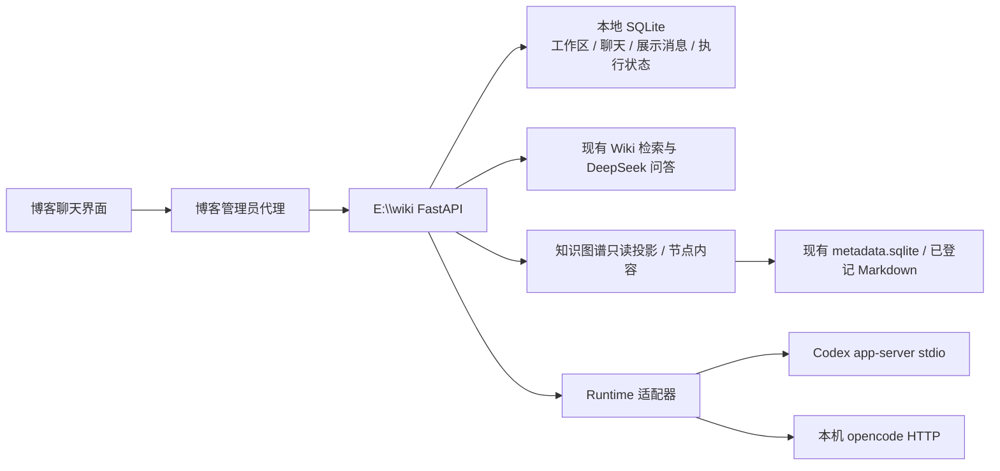

# Personal AI Hub V2：工作区、聊天与知识图谱实施计划

> 日期：2026-10-23，实施更新：2026-10-24。阶段 2–4 代码已实现；阶段 5 已完成隔离回归、真实旧记录备份与生产导入，新版后端已启动，博客待部署。真实模型双轮与管理员页面验收、实体/概念真实数据门槛仍独立保留。每阶段按 RED/GREEN 验证；使用 E:\blog / E:\wiki，不创建新工作区或默认启用子代理。

**目标：** 把现有调试表单改成日常可用的知识库与项目聊天入口，补充 Obsidian 风格的知识关系浏览，保留 Wiki、Codex、opencode 的已有能力，解决 Codex 未稳定接通的问题。

**架构：** 博客负责管理员认证、代理和聊天展示；E:\wiki 负责知识检索、SQLite 会话数据和 Runtime 适配。复用原生 Agent 的推理、工具和上下文，不开发另一套 Agent 记忆系统。

**技术栈：** React / TanStack Start / Query / Zod / Vitest，FastAPI / SQLite / Pytest / HTTPX，本地 Qwen3 embedding / BGE reranker、DeepSeek API、Codex app-server、opencode serve。图谱采用 Cytoscape.js 与 CoSE Worker；Markdown 采用 react-markdown / remark-gfm。不增加云端存储或第三种 Agent。

## 1. 本轮依据与当前真实状态

| 项目 | 已确认事实 | 不能据此认定的能力 |
| --- | --- | --- |
| Wiki 问答 | 用户截图显示 DeepSeek 已返回答案，查询链路能工作 | 不是多轮聊天验收，也未证明无答案问题能稳定拒答 |
| opencode | 用户截图显示返回电脑型号，并有原生工具结果 | 不代表工作区隔离、聊天展示和刷新恢复已完成 |
| Codex | 适配代码存在，曾读取到 ChatGPT 登录；用户页面仍报 504 | 不列为已完成接入；健康检查偶尔成功不等于真实聊天可用 |
| Codex 故障定位 | 截图请求 f46e95ae-1726-4485-8c08-2488b9a63813 出现在本地日志，reason=HUB_TIMEOUT，帧位于 account/read | 登录 RPC 更底层为什么慢仍未确定，不能直接归因于校园网或额度 |
| 错误展示 | 同一请求本地是 HUB_TIMEOUT，博客显示 HUB_UPSTREAM_ERROR | 需核对代理收到的状态、Content-Type 与安全错误结构，尚不能断言由哪层改写 |
| 聊天存储 | Codex 有 SQLite 映射；Agent 有原生历史和 JSONL 记录 | Wiki 的问答缓存不是会话历史；当前没有统一的聊天 SQLite 与工作区接口 |
| 界面 | 原生消息被放入 JSON 折叠块；Wiki 用 pre 显示回答；参数占据主页面 | 折叠一个 JSON 区域不能代替聊天消息列表 |
| 图谱数据 | 只读查询 metadata.sqlite：21 份资料、21 份摘要、5237 个片段、68 个资源；wiki_pages=0、change_sets=0，data/wiki 下没有 Markdown 页面 | 资料和片段已存在，但实体/概念页尚未形成；不能认定语义关系已经入库 |
| 图谱实现 | 配置定义 graph_db_path，但 data/indexes/graph.sqlite 不存在；当前没有知识节点/边存储和图谱读取 API | 原需求中的 nodes / edges / aliases 表是规划，不能当作已实现能力 |

规划时仅检查代码、已有日志、官方协议与本机只读接口。随后用户已授权开始实施，当前实现状态见本文第 9 节与阶段文档；尚未发起付费模型任务、创建原生 Agent 对话或重启现有服务。

协议检查基线：Codex CLI 0.159.2、opencode 1.14.19。Codex 已在临时目录导出本机 JSON Schema，存在 thread/turns/list、thread/items/list；本机 Thread.historyMode 的 schema 默认值为 legacy。最新官方文档与本机默认值存在版本差异，实现必须按实际返回的历史模式处理。opencode 的全局 /doc 当前只列出 auth/log，不能凭该文档断言目录路由已验证。

## 2. 产品范围

### 2.1 保留两个入口

- **知识库：** 内含“对话 / 知识图谱 / 资料库”三个视图，支持查找、提问、关系探索、点击节点阅读；左侧保留知识库导航与自己的聊天记录。
- **Agent Chat：** 左侧按项目工作区分组，一个工作区包含多个聊天；每个聊天绑定 Codex 或 opencode，正文只展示用户消息和最终回答。
- Personal AI Hub 是总入口；已有两个 URL 保留。未实现的 Tasks 卡片从日常界面移除。

### 2.2 “展示他们的前端”的实施含义

博客实现参考截图的统一聊天界面，通过本地服务连接原生 Runtime，不把桌面窗口作为 iframe 嵌入博客。Codex 继续使用 app-server，opencode 继续使用其 HTTP 接口。原生会话上下文和工具执行由各自 Runtime 管理，Hub 只补工作区索引、展示数据、Wiki 会话和必要的执行状态。[Codex 官方协议](https://learn.chatgpt.com/docs/app-server)、[opencode Server](https://opencode.ai/docs/server/)

### 2.3 首批明确不做

- 不接入 DeepSeek Harness；截图仅作为布局和交互参考。
- 不扫描或接管 Codex 桌面已有聊天，不同步所有原生客户端历史。
- 不新增 Agent 长期记忆系统、人格、自动总结、长期偏好学习、插件中心或自动化任务页面。知识内容的关系可视化已纳入本版，详见第 7.2 节。
- 图谱首批不自动抽取实体或生成语义关系，不为补齐图谱调用新的付费 API；不做图上编辑、文件管理器、Obsidian 插件或完整桌面软件复刻。
- 不重写原生 Agent，不训练或微调模型，不更换已验证的本地 embedding / reranker。
- 不复制截图里的附件、@文件、斜杠命令、完全权限等未实现入口。
- Codex 首批保持只读；opencode 展示实际配置，不把界面参考中的“完全权限”当成授权。网页写入审批单独安排。
- 不在首批引入 WebSocket、逐 token 流式输出、常驻 Codex 进程池或分布式任务队列。

## 3. 界面规格

### 3.1 布局草图

```text
┌ 博客导航栏 ┬ 会话侧栏                    ┬ 聊天区                         ┐
│ 可收起     │ 知识库问答 | Agent Chat     │ 当前聊天标题       连接状态 ⋯  │
│            │ 新对话                     ├──────────────────────────────┤
│            │                            │ 用户消息                       │
│            │ Agent：                    │                                │
│            │ 工作区 blog                │ 助手 Markdown 回答             │
│            │   修复登录问题              │ 引用 2 条 · 工具活动 3 次        │
│            │   阅读项目结构              │ （默认收起，点击查看）           │
│            │ 工作区 wiki                │                                │
│            │   讨论检索方案              │                                │
│            │                            ├──────────────────────────────┤
│            │ Wiki：知识库 / 历史对话     │ 多行输入框                      │
│            │                            │ 模型 · 知识库 · 设置      发送  │
└────────────┴────────────────────────────┴──────────────────────────────┘
```

- 聊天正文占主空间，阅读宽度约 760–880px；会话侧栏约 240–280px。
- 用浅色侧栏、白色正文、适量圆角和柔和分隔；沿用站点颜色变量与深色模式。中文正文采用普通无衬线字体，代码使用等宽字体。
- Hub 路由单独使用填满剩余视口的布局，去除当前 p-12 / max-w-7xl / max-w-5xl 多层收窄；博客其它后台页面保持原布局。
- 博客主导航在 Hub 可收起；避免两个完整宽度侧栏长期并列。手机端工作区/会话列表进入抽屉，输入框固定在聊天区底部。

### 3.2 主界面只保留必要内容

| 默认可见 | 按需展开 |
| --- | --- |
| 项目/聊天标题、当前执行器、实际模型或“本机配置”、连接状态 | 目录完整路径、权限说明、连接检查详情 |
| 用户消息、助手 Markdown 正文、执行中提示 | 工具活动摘要、时间、Token 等已取得的统计 |
| “引用 N 条”的紧凑入口 | 资料标题、摘录、原文链接；文件路径/行号进入二级详情 |
| 输入框、发送按钮、新对话 | BM25 / hybrid、重排、召回条数等高级参数 |

运行详情使用侧边抽屉或有高度限制的折叠区，不再把几千行 JSON 放入双列布局。原始 JSON 只作为管理员诊断视图，默认关闭且限高滚动；不展示凭证、完整注入提示或无关环境信息。

### 3.3 交互与状态

- Enter 发送、Shift+Enter 换行；中文输入法组合输入期间不能误发送。
- 聊天可新建、重命名、归档。首条用户消息生成本地截断标题，不额外调用模型生成标题。
- Agent 聊天创建时绑定工作区和 Runtime；已发送的聊天不原地切换 Runtime。选择另一 Runtime 时明确新建聊天，不混用旧上下文。
- 用户滚到历史位置时不强制拉到底部；新消息出现后提供“回到最新”。
- 一条错误提示对应一个操作，简述原因与可用动作；reason / requestId / layer 放入详情。
- 连接异常不清空历史；Codex 异常不阻断 Wiki 或 opencode。服务离线显示离线，不把数据库读取失败伪装为空聊天。
- 需要先验证登录时显示“检查中”，提供重新检查。创建空聊天不以健康探测成功为前提；提交执行前仍必须验证相应 Runtime。
- 本地 SQLite 保存聊天内容。浏览器只保存可选的界面偏好和待确认请求 ID，不承担聊天数据库职责。

### 3.4 Markdown 与引用

现有文章 ContentRenderer 接受 Tiptap JSON，不能直接接收 answer 字符串。新增聊天 Markdown 渲染层，支持段落、标题、列表、引用、表格、链接及代码块复制。

实现采用 react-markdown / remark-gfm 的 AST 与 React 元素渲染，以统一正文和内部 Wiki 链接处理；原始 HTML 不执行。链接限制协议；本地资料通过受保护的引用 ID 读取，不开放任意 path/file:// 文件接口。远程图片首批不自动加载。代码保留完整缩进、支持复制，超过 8000 字符默认折叠，复制失败显式提示。

把“实际在答案中引用的资料”和“送入模型的召回候选”分开。正文的 [n] 必须对应本轮合法引用；候选不自动标成答案依据。无效编号显示可核验性问题，不伪造来源。

### 3.5 知识图谱与阅读布局

Wiki 顶部使用紧凑的“对话 / 知识图谱 / 资料库”切换，不增加第三个 Agent 入口。进入图谱时收起聊天列表，保留窄知识库导航，把主要空间交给画布。

```text
┌ Wiki 导航 ┬ 对话  [知识图谱]  资料库                         ┐
│           ├ 搜索节点       知识网络 / 资料结构     筛选  ⋯   ┤
│           │                                  ┌─────────────┤
│           │        关系画布                   │ 选中节点     │
│           │  悬停突出相邻节点与连线            │ 类型、摘要   │
│           │  缩放 / 拖动 / 定位               │ 正文预览     │
│           │                                  │ 来源与链接   │
│           │                                  │ 打开阅读页   │
│           ├ 简洁图例              缩放 / 适应 / 重置         │
└───────────┴────────────────────────────────────────────────┘
```

- 画布沿用站点浅色/深色背景，细线、留白、轻量圆点；实体蓝、概念青绿、方法紫、项目橙、资料中性色。同一类型的颜色保持稳定，颜色之外提供类型文字。
- 默认只给选中、悬停及足够缩放比例的节点显示完整标签；长标题在预览中完整显示。节点大小按真实连接数分档并设上限，不能暗示事实可信度。
- 一次只强调当前节点的一至二跳关系，非相关连线降低透明度；方向和关系名称在选中后显示。布局完成后停止运动，尊重减少动态效果的系统设置。
- 右侧预览宽约 340–400px，可关闭；正文阅读页使用约 760–880px 阅读宽度。手机端画布占满可用区域，详情使用底部面板，全文独立阅读，不并排挤压。
- 搜索、过滤、图例都保持紧凑；布局参数、图谱版本、数据问题进入详情，不把技术控制面板放在主画布旁。
- 本草图仅约定布局，不代表当前已经有实体/概念记录。数据契约、空态和点击行为按第 7.2 节验收。

## 4. Bug 与缺失功能账本

| 编号 | 类型/优先级 | 现象或缺口 | 本版处理 |
| --- | --- | --- | --- |
| HUB-29 | 接入故障 / P0 | Codex account/read 间歇超过 8 秒，实际页面无法稳定使用 | 分离状态读取与登录探测，阶段计时，独立探测期限，完整原生聊天验收 |
| HUB-30 | 错误链路 / P1 | 本地 HUB_TIMEOUT 与博客 HUB_UPSTREAM_ERROR 不一致，同请求编号可定位 | 检查实际响应类型，保留安全原因；非 JSON 网关 504 单独标识，不编造 Runtime 原因 |
| HUB-31 | 界面误导 / P2 | Codex 下仍显示禁用的 deepseek-flash 模型框 | Codex 使用其配置/模型目录，Wiki 与 opencode 显示 DeepSeek 选项；当前请求实际会省略 DeepSeek model，不能误称后端已发错模型 |
| HUB-32 | 历史展示 / P1 | Agent 原生历史展示为 JSON，仅当前响应能显示正文 | 建立消息展示模型、原生消息适配、SQLite 展示快照和历史列表 |
| HUB-33 | 渲染与布局 / P2 | Wiki pre 显示 Markdown；引用和诊断占据主页面 | 共用安全 Markdown、消息流、紧凑引用与折叠详情 |
| HUB-34 | 问答质量 / P1 | “介绍自己”召回 DeepSeek / ESP32 等无关内容，回答反而说资料里没有自己 | 明确寒暄/助手说明入口；校准相关性门控和无答案行为，不以 Top-K 非空代表知识相关 |
| HUB-35 | 数据/实现缺口 / P1 | Wiki 页面为 0，graph.sqlite 未建立；后端没有可直接展示的实体/概念关系库 | 区分实际资料关联与待补齐语义数据；只读投影不制造关系，实体/概念验收单独设门槛 |
| V2-F01 | 新功能 | 项目工作区及按目录绑定 Runtime | 本地登记允许目录，一个工作区多个聊天；目录传至原生执行上下文 |
| V2-F02 | 新功能 | Wiki 聊天持久化与真正的多轮问答 | SQLite 消息顺序、有限最近上下文、指代问题处理；不建立长期记忆 |
| V2-F03 | 新功能 | 浏览器刷新后继续查看运行结果 | 本地执行状态与短轮询；刷新只查询，不重发任务 |
| V2-F04 | 新功能 | Wiki 资料浏览入口 | 重用现有资料列表，提供搜索、概况和只读预览；首批不增加网页导入/删除 |
| V2-F05 | 新功能 | Obsidian 风格知识图谱与双向阅读导航 | Wiki 内提供全局/局部图、搜索筛选、节点预览和全文阅读；真实关系与来源可核验 |
| V2-R01 | 兼容性风险 | Codex 当前读取完整 turns，未处理分页历史契约；尚未复现实际历史丢失 | 按 historyMode 显式适配两种契约，不能把无 turns 当没有历史 |

## 5. 本地数据与原生 Agent 的分工



### 5.1 权威数据

- 新应用数据库：`E:\wiki\data\modules\hub_chat\hub.sqlite`。聊天内容不写博客 D1、KV 或 Git。
- SQLite 是 Hub 会话目录与页面展示历史的权威存储；Wiki 对话也以它为准。
- Codex / opencode 是原生 Agent 上下文和执行状态的权威来源。SQLite 的 Agent 消息是按原生 ID 去重的展示快照，不把快照重新灌成另一套原生历史。
- Codex Home 继续为 `D:\AIData\Codex`。不迁移原生桌面历史；opencode 原生存储位置在实施时核验，不能因为设置了 OPENCODE_CONFIG 就认定其全部原生数据在 E:\wiki。
- 保留原有知识库、索引、缓存、JSONL 与 Codex 映射文件。新库不合并进现有知识元数据数据库。
- 图谱首批直接读取现有 metadata.sqlite 和已登记 Markdown，由后端生成只读展示投影；不把知识节点/边写入聊天库，不因配置中有路径就创建空 graph.sqlite。若以后接入另一份真实图谱库，另行明确数据契约，不做运行时自动切换。

### 5.2 工作区约束

本地新增 `E:\wiki\config\hub_workspaces.json`，登记可选择目录。首批登记已存在的 E:\blog、E:\wiki；截图中的 ctest 不据此猜测真实路径。

```json
{
  "version": 1,
  "roots": [
    {"key": "blog", "name": "blog", "path": "E:\\blog"},
    {"key": "wiki-project", "name": "wiki", "path": "E:\\wiki"}
  ]
}
```

- 网页创建工作区只提交 root_key，不能通过消息附带 cwd 切换到任意路径。
- 服务端校验路径存在、为目录，规范化大小写与 junction/symlink 后匹配登记项。
- 工作区可改名；有会话后不能改 root_key。换目录创建新工作区，保持原生会话原目录约束。
- Wiki 使用固定的“我的知识库”范围，不要求用户选项目目录。Agent 工作区选择不自动导入整个项目到 Wiki。
- 固定 Wiki 工作区使用 root_key=knowledge、root_path=E:\wiki\data，由知识库配置明确创建；上述目录登记 roots 只用于 Agent 项目选择。
- cwd 是执行位置，不等于文件访问沙箱。权限按实际 Runtime 验证，不能用工作区分组代替权限控制。

### 5.3 SQLite 初始契约

连接显式启用 foreign_keys、WAL 和 busy_timeout；迁移使用版本号和事务。既有文件须先核验版本与表结构，再启用 WAL，拒绝陌生库时保持原文件字节不变。以下初始表结构已实现于 schema.sql，PRAGMA 由 Store 管理；当前仅在临时库完成写入验证，生产新聊天库尚未创建：

```sql
PRAGMA foreign_keys = ON;
PRAGMA journal_mode = WAL;
PRAGMA busy_timeout = 5000;

CREATE TABLE schema_migrations (
  version INTEGER PRIMARY KEY,
  applied_at TEXT NOT NULL
);
CREATE TABLE workspaces (
  id TEXT PRIMARY KEY,
  kind TEXT NOT NULL CHECK (kind IN ('wiki', 'agent')),
  root_key TEXT NOT NULL,
  root_path TEXT NOT NULL,
  name TEXT NOT NULL,
  created_at TEXT NOT NULL,
  archived_at TEXT,
  UNIQUE (kind, root_key)
);
CREATE TABLE conversations (
  id TEXT PRIMARY KEY,
  workspace_id TEXT NOT NULL REFERENCES workspaces(id),
  runtime TEXT NOT NULL CHECK (runtime IN ('wiki', 'codex', 'opencode')),
  title TEXT NOT NULL,
  preferred_model_id TEXT,
  legacy_session_id TEXT,
  native_session_id TEXT,
  created_at TEXT NOT NULL,
  updated_at TEXT NOT NULL,
  archived_at TEXT,
  UNIQUE (runtime, legacy_session_id),
  UNIQUE (runtime, native_session_id)
);
CREATE TABLE turns (
  id TEXT PRIMARY KEY,
  conversation_id TEXT NOT NULL REFERENCES conversations(id),
  client_request_id TEXT NOT NULL,
  input_hash TEXT,
  origin TEXT NOT NULL CHECK (origin IN ('v2', 'legacy')),
  state TEXT NOT NULL CHECK (state IN (
    'queued', 'preparing', 'submitting', 'running',
    'completed', 'failed', 'unknown', 'interrupted'
  )),
  settings_json TEXT NOT NULL,
  native_turn_id TEXT,
  pending_metadata_json TEXT,
  error_reason TEXT,
  request_id TEXT NOT NULL,
  created_at TEXT NOT NULL,
  updated_at TEXT NOT NULL,
  UNIQUE (conversation_id, client_request_id),
  CHECK (origin = 'legacy' OR input_hash IS NOT NULL)
);
CREATE TABLE messages (
  id TEXT PRIMARY KEY,
  conversation_id TEXT NOT NULL REFERENCES conversations(id),
  turn_id TEXT NOT NULL REFERENCES turns(id),
  seq INTEGER NOT NULL CHECK (seq > 0),
  role TEXT NOT NULL CHECK (role IN ('user', 'assistant')),
  content_md TEXT NOT NULL,
  native_message_id TEXT,
  created_at TEXT NOT NULL,
  UNIQUE (conversation_id, seq),
  UNIQUE (turn_id, role),
  UNIQUE (conversation_id, native_message_id)
);
CREATE TABLE citations (
  message_id TEXT NOT NULL REFERENCES messages(id),
  ordinal INTEGER NOT NULL CHECK (ordinal > 0),
  used_in_answer INTEGER NOT NULL CHECK (used_in_answer IN (0, 1)),
  generation TEXT NOT NULL,
  source_snapshot_json TEXT NOT NULL,
  PRIMARY KEY (message_id, ordinal)
);
CREATE TABLE turn_details (
  turn_id TEXT PRIMARY KEY REFERENCES turns(id),
  timings_json TEXT NOT NULL,
  retrieval_json TEXT NOT NULL,
  tool_summary_json TEXT NOT NULL
);
CREATE TABLE legacy_imports (
  source_path TEXT NOT NULL,
  source_key TEXT NOT NULL,
  content_sha256 TEXT NOT NULL,
  imported_at TEXT NOT NULL,
  PRIMARY KEY (source_path, source_key)
);
CREATE INDEX conversation_workspace_updated
  ON conversations(workspace_id, updated_at, id);
CREATE INDEX messages_conversation_seq
  ON messages(conversation_id, seq);
```

服务层必须再验证 message 的 conversation_id 与 turn 的 conversation_id 一致；runtime 与工作区类型一致；同一聊天同一时刻只允许一个未终态 turn，未核验的 unknown 也阻止新执行。接受请求、分配 seq、保存原问题在同一 BEGIN IMMEDIATE 写事务；完成回答、引用快照和 completed 状态在同一写事务。输入 hash 包含原问题的精确 UTF-8 文本与固定设置，不压平代码空白；时间统一为 UTC ISO 8601。

引用快照保存标题、源 ID、相对路径、行号、摘录、URL 与原 generation。聊天读取不实时重查资料后改写旧引用。

### 5.4 历史迁移

1. 使用 SQLite backup API 备份现有数据库；记录 JSONL 文件校验和。先在临时副本执行导入和计数对照，不移动原件。
2. 从 Codex 映射、Hub JSONL 与明确的原生会话 ID 建立对应关系；不按标题猜测所有权，也不扫描桌面全部聊天。
3. 旧 opencode 会话仅处理 Hub 记录明确引用且目录可核验的条目；无目录证据进入“待归属旧会话”，禁止执行直至用户明确归属。
4. 保留 pending / native_id / baseline_ids / pending_turn_id；不能把结果未知改成成功或空会话。缺失原问题/时间/模型时标为元数据缺失，不捏造消息。
5. Wiki QA cache 不导入成聊天历史。缓存条目没有可靠的会话和轮次关系。
6. 以稳定的原记录键/原生 ID 去重；同键内容变更明确报告冲突。重复导入不增加相同消息。
7. V2 切换时安排一次短维护窗口。避免旧 V1 写入口继续单独写 JSONL：旧 Agent 写请求显式返回 HUB_UPGRADE_REQUIRED，提示刷新；MCP 知识查询继续保持原契约。保留旧文件供复核。

## 6. API 与执行契约

### 6.1 新增受保护接口

所有接口仍经博客 adminMiddleware，再携带 X-Hub-Token 请求 FastAPI；所有新本地路由也校验 token。

沿用 `{error:{reason,message,layer,requestId}}`；新增原因统一加入后端、博客和 Zod 契约：WORKSPACE_NOT_REGISTERED、WORKSPACE_PATH_UNAVAILABLE、WORKSPACE_CONFIG_CHANGED、CONVERSATION_NOT_FOUND、CONVERSATION_BUSY、REQUEST_ID_CONFLICT、HUB_UPGRADE_REQUIRED、CODEX_AUTH_TIMEOUT、HUB_UPSTREAM_TIMEOUT。配置/参数错误、找不到会话、冲突、上游超时分别用 422/404/409/504；鉴权仍为 401。上游非 JSON 504 使用 HUB_UPSTREAM_TIMEOUT，不伪称已知 Runtime 内部错误。

工作区登记文件缺失、版本错误或结构错误使用 WORKSPACE_CONFIG_INVALID / 503；不能隐式选择其它目录或自动生成替代登记项。

| 方法/路径 | 输入要点 | 输出 |
| --- | --- | --- |
| GET /hub/workspace-roots | 无 | 本地已登记的目录及是否可用 |
| GET /hub/workspaces | kind、游标 | 工作区列表 |
| POST /hub/workspaces | root_key、name | 已验证工作区 |
| GET /hub/workspaces/{id} | 已登记工作区 ID | 目录绑定、名称与当前可用性 |
| PATCH /hub/workspaces/{id} | name | 只改显示名，不能改目录绑定 |
| GET /hub/conversations | workspace_id、游标 | 聊天列表，每页最多 30 条 |
| POST /hub/conversations | workspace_id、runtime、title、model_id | 新聊天；不提交模型任务 |
| PATCH /hub/conversations/{id} | title 或 archived=true/false | 元数据；归档/恢复不删除历史，不改执行器或目录 |
| GET /hub/conversations/{id} | id | 元数据、当前未终态 turn |
| GET /hub/conversations/{id}/messages | before_seq、limit<=50 | 规范化消息与引用摘要 |
| GET /hub/conversations/{id}/requests/{request_id} | 原 client_request_id | 只找回已接受请求，不提交新任务；未接受返回 404 |
| POST /hub/conversations/{id}/turns | 下方 turn 输入 | 202 + turn_id；幂等重复返回已有 turn |
| GET /hub/turns/{id} | id；显式 verify_native=true | 默认仅查 SQLite；显式核验 unknown 时只读原生历史，不重新执行 |
| GET /hub/turns/{id}/details | id | 按需读取的诊断/召回/工具摘要 |
| GET /hub/messages/{id}/citations/{ordinal} | 已保存引用 ID | 可核验的引用快照，不接受任意路径 |
| GET /hub/runtimes | 工作区 ID | Runtime 状态快照与检查时间 |
| POST /hub/runtimes/{runtime}/checks | 工作区 ID | 202 + check_id，执行合并的只读探测 |
| GET /hub/runtimes/{runtime}/models | 工作区 ID | 该 Runtime 的模型目录/已配置模型 |
| GET /kb/sources | 现有接口保留 | MCP 旧列表不变；V2 资料库复用 graph/search 的 source 类型过滤、分页与 revision |
| GET /kb/sources/{id}/preview | 已登记资料 ID | 有界的只读预览与元数据 |
| GET /kb/graph/status | scope=knowledge 或 evidence | 图谱版本、真实节点/边计数、实体/概念覆盖与数据问题 |
| GET /kb/graph | scope、筛选、center_id、depth、revision、数量上限 | 有界节点与边、实际返回数、匹配总数、clipped |
| GET /kb/graph/search | scope、q、类型、revision、游标 | 在完整所选范围内搜索节点；每页最多 25 条 |
| GET /kb/graph/nodes/{id} | 稳定节点 ID、revision | 标题、类型、别名、来源、入链/出链摘要及分页游标 |
| GET /kb/graph/nodes/{id}/content | id、revision、内容游标 | 有界正文或已解析片段、内容类型、内部链接与后续游标 |

搜索游标与消息游标都由服务端生成，SQL 参数化。列表只提供当前管理员所属本机 Hub 会话；不直接转发 Runtime 的全局 session.list 充当工作区列表。

### 6.2 Turn 输入与结果

```json
{
  "client_request_id": "71f9a516-9c08-4caf-93c4-b9d8f0c4ec40",
  "question": "这个项目如何启动？",
  "model_id": null,
  "answer_mode": "chat",
  "knowledge": {"enabled": true, "retrieval_mode": "hybrid", "rerank_mode": "local"}
}
```

- question 非空且不超过 16000 字符。客户端在发送前生成 request ID。
- chat 模式的 model_id=null 仅对 Codex 表示明确使用本机配置；Wiki 问答/opencode 必须传所选 DeepSeek 型号。Wiki 显式 search 模式允许 null，不调用问答模型。
- Wiki 的知识模式必须 enabled=true；助手说明是独立意图，不因此转成外部通用问答。Agent 可以由用户明确关闭知识注入，界面显示本轮选择。
- runtime、cwd 来自会话与已验证工作区，不允许在此输入中覆盖。
- 相同 conversation + client_request_id + 相同输入返回原 turn，不再次调用 Runtime/LLM；相同 ID 不同输入返回 REQUEST_ID_CONFLICT。
- 同一进程内相同 queued turn 只排队一次；SQLite claim 仍负责唯一执行。全局最多 8 个未终态请求（包括 unknown），超过返回 HUB_BUSY，不无限积累后台作业。
- 异步接受后，界面每 1–2 秒查询执行状态，完成后读取消息。轮询只读取状态，不重发执行。
- 刷新后通过会话元数据中的未终态 turn 恢复观察；提交响应丢失时先核对 request ID，不直接新建另一任务。
- 会话元数据返回最近 V2 turn 的 last_settings；旧导入不推断不存在的设置。提交的型号与原生实际返回型号分别显示在本轮详情。
- 首批仍保留 Wiki 40 秒、Agent 65 秒的本地任务期限。短轮询解决浏览器请求和任务生命周期耦合，延长任务期限另行评估。

```json
{
  "turn_id": "turn_7c21",
  "conversation_id": "conversation_b84c",
  "state": "queued"
}
```

状态含义：queued 尚未调度；preparing 正在准备上下文；submitting 已持久化外部提交意图；running 已取得执行确认；completed/failed/interrupted 为已核验终态；unknown 表示可能已提交但无法确认。服务重启后不自动重放未完成 turn；submitting/running 必须核对原生记录，不能直接重置 queued。

原生任务的停止按钮不进入第一批交付，避免界面先声称已取消而后台继续工作。未来实现时必须以原生终态确认，不以 HTTP 取消代替工具停止。

### 6.3 Codex 检查与模型

- 读取状态只返回最近探测快照，不为每个页面读请求同步启动 app-server 并等待 account/read。
- 检查通过显式 POST 发起，同一工作区的并发探测合并。首批采用单次受管短进程，独立总预算 20 秒，不新增常驻进程池。
- 快照使用 unverified/checking/ready/error/stale 状态；ready 有效期 60 秒，过期后显示未验证，不拿旧 ready 冒充当前成功。快照按 Runtime、规范化工作区及 Codex Home 隔离，不作为失败后切换执行器的依据。
- 20 秒是初始探测预算，不是慢响应根因结论。记录 initialize、account/read、清理的分段耗时和 request ID，保留受控错误；不记录登录凭证。
- 实际执行仍独立校验账号、cwd 和只读策略；探测失败不自动提交模型任务，不自动改账号/模型。
- Codex 模型来自本机配置和 model/list；目录失败显示不可获取，不用 DeepSeek 选项代替。实际模型从原生任务响应回写，模型目录/登录成功都不是额度可用证明。[OpenAI Docs：模型目录](https://learn.chatgpt.com/docs/app-server#list-models-modellist)

### 6.4 工作区与原生历史

- Codex 的 cwd 绑定会话工作区；不同工作区不共用当前 CodexClient.cwd。按原生返回的 historyMode 显式读取 legacy 或分页历史。
- paginated 使用 thread/turns/list / thread/items/list，不能只看空 turns。legacy 保留已核验契约。缺少模式或不支持的响应明确报协议错误，不尝试另一 Runtime。
- opencode 需要把目录传入其实际支持的项目/实例路由，创建、读取、发送都使用相同目录；用只读路径回读和协议替身断言核验，不能只在网页加分组。
- 页面只显示用户原始问题和助手文本。知识注入提示、工具参数、工具 stdout、内部事件进入受保护详情，不充当新的用户消息。
- 同一 turn 的中间助手说明归入活动详情，正文展示原生已确认的最终回答；多个最终文本片段按原生顺序合并，不重复追加整段回答。
- 完成消息按 native ID 去重；未知事件保留类型诊断，不展示为伪造的助手答案。原生历史缺失时明确标注，不从展示缓存推断执行未发生。

## 7. Wiki 问答与知识图谱

### 7.1 问答改进

- “你好/你是谁/介绍自己”走明确的助手说明意图，说明这是本地个人知识库入口；不强行召回 ESP32 文档。复合请求中包含知识问题时仍处理该知识问题。
- 普通知识问题保留本地 hybrid + BGE 重排。新增基于本地标注题校准的相关性门控；不把 Top-K 非空作为有关证据，也不把不同检索模式的分数混用同一阈值。
- 无充分证据时明确“当前知识库未找到足够依据”，给出可澄清方向；不静默转成外部通用模型回答。
- 真正多轮要带入有限最近上下文：最近 3 轮，最多 24KiB UTF-8 文本；超预算按完整较早轮次移除。它用于理解指代，不形成长期记忆或新知识事实。
- 需要指代解析时使用同一已选择 DeepSeek 型号做受限问题改写，预算最多 10 秒且计入 Wiki 总 40 秒。新增请求可能产生一次额外 DeepSeek 调用，界面高级说明需写清；自动测试不调用真实 API。
- 指代不明确就提澄清问题，不猜实体。旧回答仅用于定位用户所指，事实答案仍检索当前知识证据。
- Wiki 新聊天接口首批关闭答案缓存读写，避免“它怎么用”等相同问题跨会话命中旧答案；保留 embedding/rerank 缓存。原单轮 MCP/query 的精确正反馈缓存保持原契约。
- 每轮保存原问题、实际检索问题、回答、引用快照和 generation，支持关闭页面后恢复。资料列表只读；不增加自动整理、自动删除和自动记忆写入。

### 7.2 Obsidian 风格知识图谱

#### 7.2.1 实际数据与交付边界

用户要求的是实体、概念等知识节点与关系网，并能点击查看内容。2026-10-23 只读核验确认，现有应用目前具备资料—摘要—片段的明确关联，Personal Wiki 支持 concept / entity / method / project 等页面类型及 source_refs 字段，但实际页面数为 0。`graph.sqlite` 仅有配置路径，没有数据库文件或读写实现。

首批提供两种由用户明确选择的范围：

| 范围 | 数据来源与含义 | 当前实际情况 |
| --- | --- | --- |
| 知识网络 knowledge | 已登记且 active 的 Wiki 页面、其中明确的内部链接，以及可解析 source_refs 指向的资料 | Wiki 页面为空，显示“尚无已登记的知识节点”；提供“查看资料结构”按钮，由用户点击切换 |
| 资料结构 evidence | sources、summaries、chunks、assets 的 source_id 归属关系 | 已有数据，可独立验收资料浏览和结构展开 |

不从资料名、关键词命中或向量相似度推导“属于/导致/相关”等语义关系，不把两种范围自动互换。若真实实体库在其它位置，先核实并登记读取契约；若没有，实体/概念内容补齐是待确认的数据工作，本轮不默默增加生成或导入任务。**资料结构可用与实体/概念图谱完整交付分别记录；当前后者受 HUB-35 阻塞。**

#### 7.2.2 节点与边的只读模型

- 节点 ID 使用 `wiki:<wiki_page_id>`、`source:<source_id>`、`summary:<summary_id>`、`chunk:<chunk_id>`、`asset:<asset_id>`；标题可改而 ID 不变，不用数组下标或标题充当 ID。
- 节点返回 id、kind、title、aliases、status、content_available、内容类型与关联计数。Wiki 的 kind 使用实际 node_type；不预造 concept/entity 记录，也不增加没有真实来源的标签节点。
- 资料关系只取真实 source_id 外键关联，类型为 has_summary / has_chunk / has_asset。只绘制端点均有效的边；孤儿记录、坏字段和缺文件进入可见的数据质量清单，不静默省略问题。
- Wiki 关系仅来自明确 source_refs 和正文内部链接，类型分别为 cites / wiki_link。首批解析 `[[页面名]]`、`[[页面名|显示名]]` 和 `[[页面名#章节]]`，以实际 ID、唯一标题或唯一别名解析目标；正文中的 Markdown 代码块与行内代码不产生关系。
- 同名/别名歧义、无目标链接和不可解析来源引用单独返回状态，不猜目标；不创建可打开但没有正文的假实体。前端可以查看未解析链接的文字与原因。
- 每条边有稳定 ID、source、target、kind、evidence_refs。依据至少能定位源记录或 Wiki 页面中的链接位置；相同端点/类型归并展示时保留全部依据。反向链接由这些真实边反查，不额外生成第二份事实。
- 基于一个 SQLite 读事务的元数据快照及相关 Markdown 内容哈希生成 revision；不能只看数据库文件 mtime，避免 WAL 写入或正文变更未反映到版本。浏览图谱不更改数据库、Markdown、索引或已存关系。

#### 7.2.3 搜索、全局图与局部图

- “全局图”表示当前范围的关系概览，不承诺把无限数据一次画全。默认知识网络展示知识页及其引用资料；资料结构展示资料/摘要，5237 个片段和资源按需展开。
- 筛选支持实际节点类型、关系类型、是否显示孤立节点；标题/别名搜索覆盖整个所选范围，不能只搜索当前画布已加载节点。搜索结果点击后定位并打开该节点的局部图。
- 局部图默认一跳，可明确切换两跳；入链和出链都可浏览。点击相邻节点可继续探索，并保留回到上一个中心的导航记录。
- 首次请求默认最多 300 节点、900 边；硬上限为 500 节点、1500 边。后端按明确且稳定的次序选择有界结果，保留中心节点；返回匹配总数、可见数量和 clipped。达到上限显示“当前为部分关系，请搜索或缩小范围”，不把截取结果叫作完整图。
- 不全量摊开片段。资料详情提供摘要、片段列表和资源计数，需要时由用户选择展开；分页和读取上限在服务端执行。

#### 7.2.4 点击阅读与双向导航

1. 单击节点，右侧打开标题、类型、正文预览、来源和真实入链/出链。只请求当前节点的详情与正文，不随全图批量下载内容。
   单击关系线时显示关系类型、方向和依据，点击依据进入对应页面位置；关系的出处不能只依赖悬停提示。
2. 点击“打开阅读页”进入 Wiki 内的只读阅读视图；Wiki 页和摘要显示 Markdown。资料节点先显示资料概况和摘要入口，片段入口明确标为“已解析内容”，不把摘要冒称原文全文。
3. 阅读正文中的内部链接、侧栏关系或反向链接，可以进入对应节点；“在图中定位”返回局部图。资料库列表也能打开同一阅读视图，形成图谱、资料库与正文之间的统一导航。
4. URL 用已验证的 view / scope / node 参数保存当前节点，支持复制链接、刷新和浏览器后退；返回画布恢复缩放与中心。只保存界面状态，不把全文或聊天写进 URL/localStorage。
5. 在正文被删除、节点不存在、版本变化或目标链接歧义时展示具体状态；不自动打开另一个同名页面，不改用其它文件充当内容。

正文分段读取，单次最多 64KiB UTF-8，提供明确游标与剩余提示，不无提示截断全文。内容响应声明 wiki_markdown / summary_markdown / chunk_text / asset_text 等真实类型。代码、内部链接和引用共用安全 Markdown 约束；PDF、图片等原始资源首批只展示安全元数据与已提取文字，不承诺网页内编辑或所有格式原生预览。

#### 7.2.5 前端实现与视觉验收

采用 Cytoscape.js 渲染浏览器画布，React 管理搜索、筛选、预览和阅读状态。按客户端视图动态加载，避免把 DOM/Canvas 初始化带进 SSR。首批使用内置 CoSE 布局，布局计算放在浏览器 Worker，通过坐标返回展示；卸载、换图或改筛选时取消旧计算，防止旧结果覆盖新图。不同时引入多套图引擎或自动换引擎。

图谱关系、知识范围和只读正文由后端提供；坐标与布局只是浏览器展示状态。画布不依赖 LLM、云图数据库或额外付费 API。布局失败明确提示重试，不呈现示例数据冒充真实知识。Canvas 之外提供可键盘操作的搜索结果与关联列表，支持 Esc 关闭详情、按钮缩放及触屏操作。

视觉按第 3.5 节执行，验收桌面与手机、浅色与深色，以及空库/孤立节点/中文长标题。300 节点、900 边在本机实测拖动和缩放，目标稳定达到 30fps；记录实际设备和瓶颈，超出预算继续收紧展示范围，不能以隐藏截断换取通过。检查重复进入视图后的 Canvas / Worker / 事件监听释放。

交互参考 [Obsidian 官方 Graph view](https://obsidian.md/help/plugins/graph)；技术依据为 [Cytoscape.js 官方文档](https://js.cytoscape.org/) 与[布局说明](https://blog.js.cytoscape.org/2020/05/11/layouts/)。实现已落地。300 节点/900 边隔离 Canvas 实测 Worker 布局约 2.793 秒；当前自动化浏览器的无操作 rAF 基线也只有约 1fps，不能据此认定真实拖动达到或未达到 30fps，此项保留实际浏览器验收。视图返回复用已保存坐标与视口，尺寸变化保持图中心，最多保留 20 个视图，均不含正文存储。

#### 7.2.6 权限、错误与版本一致性

- 图谱、搜索、节点与正文读取全部经博客管理员代理和本地 X-Hub-Token；首批不公开分享私人节点，不新增 MCP 图谱工具。
- 网页只提交稳定节点 ID。后端按元数据定位并复用资料预览的路径校验，限制已登记知识目录，校验规范化路径和 junction/symlink；不接受任意 path、file:// 或远程抓取地址。
- 所有查询以 scope、revision、筛选和中心构成 Query key。切换节点取消旧请求，重复到达的旧详情不替换当前预览；画布返回的每条边必须同时包含两个端点节点。未加载的关联只在详情列表标注并按需展开，不能画悬空线。
- 无知识节点返回成功空结果与真实 coverage；数据库不可读、数据结构损坏、源文件不存在分别显式报告，不能都返回“暂无数据”。新增 GRAPH_DATA_UNAVAILABLE=503、GRAPH_NODE_NOT_FOUND=404、GRAPH_CONTENT_UNAVAILABLE=404、GRAPH_SNAPSHOT_CHANGED=409，三端错误契约同步。
- 节点详情和正文带 revision；版本改变先提示刷新当前图，不混入旧图关系。服务离线时保留当前画布并标记离线/旧数据，不把旧快照标为实时。

#### 7.2.7 完成条件

- [ ] 当前真实库可以浏览资料、摘要及按需加载的片段；所有可打开节点均能进入正确内容。
- [ ] 隔离测试以真实表结构创建少量概念、实体和明确内部链接，验证全局图、两跳图、来源、歧义、缺链接与双向导航；不写入生产知识库。
- [ ] 未登录/非管理员/缺本地 token 均不能读取；越权路径、恶意 Markdown、坏 ID、游标和数量上限有隔离测试。
- [ ] 搜索覆盖未绘制节点；大图如实标注裁剪；连续点击、刷新、后退和版本变化不会串内容。
- [ ] 用户真实知识数据中存在实体/概念页与可核验关系，且能从关系进入其正文，才记实体/概念图谱验收完成。测试夹具通过、空态正常或资料图完成均不解除 HUB-35 的真实数据阻塞。

## 8. 文件边界与职责

### E:\wiki 新增

| 文件 | 职责 |
| --- | --- |
| personal_wiki_brain/conversations/store.py | SQLite 事务、列表、消息顺序、执行记录和幂等 |
| personal_wiki_brain/conversations/schema.sql | 上述数据库迁移基线 |
| personal_wiki_brain/conversations/models.py | 输入输出 DTO 与状态枚举 |
| personal_wiki_brain/conversations/workspaces.py | 登记目录解析与规范化校验 |
| personal_wiki_brain/conversations/service.py | 会话创建/消息提交/归档业务 |
| personal_wiki_brain/conversations/coordinator.py | 单机受管执行、完成入库、重启核验；不做自动重放 |
| personal_wiki_brain/conversations/native_messages.py | 两种 Runtime 到展示消息的转换 |
| personal_wiki_brain/conversations/legacy_import.py | 非破坏性、可重复的旧记录导入 |
| personal_wiki_brain/agent/runtime_health.py | 合并探测与状态快照 |
| personal_wiki_brain/api/conversations.py | 新聊天 API；统一 token 依赖 |
| personal_wiki_brain/chat/conversation_service.py | Wiki 有限上下文与问题改写 |
| personal_wiki_brain/retrieval/relevance.py | 相关性策略与标定版本校验 |
| personal_wiki_brain/knowledge_graph/models.py | 节点、关系、范围、版本和有界读取 DTO |
| personal_wiki_brain/knowledge_graph/service.py | 现有元数据与 Markdown 的只读投影、搜索与一至二跳查询 |
| personal_wiki_brain/knowledge_graph/wiki_links.py | 明确内部链接/来源引用解析、别名歧义与依据位置 |
| personal_wiki_brain/api/knowledge_graph.py | 受保护图谱、节点与正文 API；复用资料预览的内容读取 |
| config/hub_workspaces.json | 本机登记目录，不放入博客仓库 |

修改 `personal_wiki_brain/api/server.py` 接入路由与服务；修改 `agent/codex_runtime.py` / `opencode_runtime.py` 传递工作区及规范化历史；修改 `chat/service.py` / `llm/deepseek.py` 增加显式上下文/缓存控制。现有正确的 generation、向量、重排和启停逻辑不重写。

### E:\blog 新增

| 文件 | 职责 |
| --- | --- |
| src/features/personal-ai-hub/schema/hub-chat.schema.ts | V2 Zod 契约，拒绝缺少 ID/状态的假成功 |
| src/features/personal-ai-hub/service/hub-chat.service.ts | V2 管理员代理与安全错误 |
| src/features/personal-ai-hub/api/hub-chat.admin.api.ts | 受 adminMiddleware 保护的 Server Function |
| src/features/personal-ai-hub/queries/hub-chat.queries.ts | 含工作区/会话的 Query key、轮询、失效 |
| src/features/personal-ai-hub/components/hub-chat-shell.tsx | 共享视口布局 |
| src/features/personal-ai-hub/components/hub-chat-sidebar.tsx | 工作区/聊天列表与分页 |
| src/features/personal-ai-hub/components/hub-message-list.tsx | 消息正文、滚动与状态 |
| src/features/personal-ai-hub/components/hub-composer.tsx | 输入法、发送互斥及紧凑设置 |
| src/features/personal-ai-hub/components/hub-markdown.tsx | 安全 Markdown 渲染 |
| src/features/personal-ai-hub/components/hub-message-details.tsx | 引用/工具/诊断抽屉 |
| src/features/personal-ai-hub/components/wiki-source-browser.tsx | 资料列表与只读预览 |
| src/features/personal-ai-hub/schema/wiki-graph.schema.ts | 图谱 DTO、查询参数与错误契约 |
| src/features/personal-ai-hub/service/wiki-graph.service.ts | 只读图谱代理，复用现有鉴权与错误处理 |
| src/features/personal-ai-hub/api/wiki-graph.admin.api.ts | 图谱受保护 Server Function |
| src/features/personal-ai-hub/queries/wiki-graph.queries.ts | 范围/版本隔离、取消旧请求与按需读取 |
| src/features/personal-ai-hub/components/wiki-graph-view.tsx | 图谱画布、搜索、筛选与紧凑图例 |
| src/features/personal-ai-hub/components/wiki-node-preview.tsx | 节点预览、来源、入链与出链 |
| src/features/personal-ai-hub/components/wiki-reader.tsx | 只读正文、内部链接与返回图谱导航 |
| src/features/personal-ai-hub/utils/wiki-graph-layout.worker.ts | 有界图的布局计算与坐标返回 |

修改两个现有 Hub route 使用共同界面；修改现有代理处理 HUB-30；仅对 Hub 路由调整 `src/routes/admin/route.tsx`、`src/components/admin/side-bar.tsx` 的布局模式。既有管理员鉴权、其它后台页面和公开博客不改语义。

## 9. 开发步骤与逐阶段验收

每阶段执行：编写下列失败用例 → 运行并确认目标失败 → 完成列出的最小实现 → 相关与必要全量测试 → 更新阶段文档并记录提交。不是完成整个计划后才验收。

### 阶段 0：先让 Codex 可用，修正错误与模型展示

**代码范围：** runtime_health.py、codex_runtime.py、api/server.py；博客现有 service/schema/Agent route。

- [x] 记录 account/read 分段耗时；为慢探测写最小失败用例，断言 GET 状态不等待慢 RPC，POST 检查返回 checking，结束后 ready/error 有明确时间。
- [x] 给 JSON HUB_TIMEOUT、非 JSON 504、响应重定向和执行结果未知分别写代理回归；不把非 JSON 网关错误伪造为已知 Codex 登录错误。
- [x] 实现 20 秒异步合并探测和过期状态；保留执行时独立鉴权，禁止执行重试或切换 Runtime。页面在 ready 到期时只重新 GET 状态，不发起新探测或任务。
- [x] Codex 模型框改为“使用本机 Codex 配置”；切回 opencode 才展示 DeepSeek 型号。故障仅影响对应执行器。原生模型目录读取留在阶段 2，首批不伪造可选型号。
- [ ] 用同请求编号对照本地、Tunnel、博客代理；用户手动验证一次新建会话、连续两轮读项目文件和刷新恢复。

测试：`E:\wiki\tests\test_runtime_health.py`、现有 `test_codex_runtime.py` / `test_fastapi_hub_api.py`；博客现有 `personal-ai-hub.service.test.ts`、`agent-chat-page.test.ts`。

```typescript
it("保留 Hub 的超时原因", async () => {
  const result = await getAgentStatus({
    env: { PERSONAL_AI_HUB_API_URL: "https://hub.test", PERSONAL_AI_HUB_API_TOKEN: "test" },
    fetch: async () => Response.json({ error: { reason: "HUB_TIMEOUT", layer: "agent_runtime" } }, { status: 504 }),
  }, "codex");
  expect(result.error?.reason).toBe("HUB_TIMEOUT");
});
```

该用例可能在当前代码已通过：它用于固定正常 JSON 契约；新增失败回归必须包含截图对应响应类型的隔离重放，不能用已通过测试冒充找到根因。

**阶段通过条件：** 读状态不因慢登录直接挂起；20 秒探测失败明确可见；实际双轮 Codex 读文件成功才把接入记为完成。仅健康检查成功仍不算。

### 阶段 1：工作区与 SQLite 聊天底座

**代码范围：** conversations/models.py / schema.sql / store.py / workspaces.py / service.py / legacy_import.py / api/conversations.py，及 workspace 登记配置。

Store 接口约定：`ConversationStore(db_path)`；`create_workspace(root_key, root_path, name, kind)`、`create_conversation(workspace_id, runtime, title, model_id)` 返回字符串 ID；`accept_turn(conversation_id, client_request_id, question, settings)` 返回包含 id 的 turn 字典。

读取边界为 get_workspace / get_conversation / get_turn / list_messages；`complete_turn(turn_id, content_md, citations, timings, recall_items, tool_summary, native_message_id=None)` 在单事务中保存助手消息、引用快照、详情和终态。重复完成必须具有相同正文、原生消息 ID 和引用快照，返回已有消息；不能追加第二条助手消息或改写首次保存的引用、运行详情。

- [x] 先测试两个工作区、多聊天、分页顺序、目录缺失/越界/大小写/junction、事务失败不留半条消息。Windows 真实 Junction 改目标后会拒绝旧绑定。
- [x] 同一请求 ID 两次提交只生成一个 turn，换内容必须冲突；并发 seq 不重复。同会话忙或 unknown 时明确报 busy。
- [x] 实现 schema、参数化 SQL 与目录登记；新增 API 的 token 依赖复用统一认证。目录、会话重命名与归档/恢复均保持绑定不变。
- [x] 临时副本演练导入、重复导入、缺失元数据、旧 pending 保留；生成计数差异，不操作生产旧库。2026-10-24 真实副本及生产新库均导入 1 工作区 / 1 聊天 / 2 消息，原来源校验不变。
- [x] 重启测试实例后按同会话 ID 读回消息；仅数据层/管理 API 已完成，真实问答和原生 Runtime 尚未写入此新库。

旧记录准备状态：LegacyImporter.inspect 仅只读清点四个明确的 Hub 文件，去重两份 JSONL、报告冲突/缺失元数据/未归属目录，并保留 Codex pending 原始字段。真实库只读清点为 1 条 opencode 会话、1 次完成运行，归属 wiki-project；源文件校验和未变，新生产 hub.sqlite 未创建。副本写入导入、SQLite backup 与切换演练尚未实现，上述导入复选框继续保留未完成。

```python
def test_same_operation_creates_only_one_turn(tmp_path):
    store = ConversationStore(tmp_path / "hub.sqlite")
    workspace = store.create_workspace("blog", str(tmp_path), "blog", "agent")
    chat = store.create_conversation(workspace, "codex", "read", None)
    settings = {"model_id": None, "answer_mode": "chat", "knowledge": {"enabled": True, "retrieval_mode": "hybrid", "rerank_mode": "local"}}
    first = store.accept_turn(chat, "71f9a516-9c08-4caf-93c4-b9d8f0c4ec40", "read README", settings)
    second = store.accept_turn(chat, "71f9a516-9c08-4caf-93c4-b9d8f0c4ec40", "read README", settings)
    assert first["id"] == second["id"]
```

测试新文件：`E:\wiki\tests\test_conversation_store.py`、`test_hub_workspaces.py`、`test_legacy_conversation_import.py`、`test_conversation_api.py`。

**阶段通过条件：** 数据留在本地，重启可读回；非法目录不能执行；重复提交和导入不增生记录；旧文件未删除。

### 阶段 2：原生 Agent 工作区、历史与异步观察

**代码范围：** 两个现有 Runtime、native_messages.py、coordinator.py、conversations API。

- [x] 原生协议替身先断言目录：blog 会话每次 start/resume/send 使用 E:\blog，wiki 项目使用 E:\wiki；交叉会话请求拒绝。
- [x] Codex 的 legacy/paginated、空页面非空历史、分页游标、失联 pending 均写回归。opencode 不把跨项目 session.list 当 Hub 聊天目录。
- [x] 规范化用户原问题与助手最终文本；对工具/事件生成摘要，正文不泄漏整段知识注入提示。
- [x] 接受 turn 的事务先于执行，返回 202；后台结果完成入库。原生提交意图先入库，未知状态保持原 ID，不能在重启后重放。
- [x] 刷新只 GET 同一个 turn；切会话不把旧请求结果塞进新会话；进程退出明确记录状态。

```python
def test_native_tool_events_are_not_chat_messages():
    native = [{"info": {"id": "native_assistant", "role": "assistant"}, "parts": [
        {"type": "tool", "tool": "bash", "state": {"status": "completed", "output": "tool-only-output"}},
        {"type": "text", "text": "项目标题是 example"}
    ]}]
    messages = normalize_opencode_messages(native)
    assert [item["content_md"] for item in messages] == ["项目标题是 example"]
    assert messages[0]["native_message_id"] == "native_assistant"
```

`normalize_opencode_messages(native)` 接口定义于 native_messages.py，返回只含可展示消息的字典列表；工具摘要另行存入 turn_details。

测试：现有两个 Runtime 测试、新 `E:\wiki\tests\test_native_messages.py`、`test_turn_coordinator.py`。

**阶段通过条件：** 两目录与两 Runtime 不串上下文；刷新能读回完成结果；任务超时不重复执行；只有 Hub 创建/明确导入的对话进入列表。

### 阶段 3：Wiki 问答、资料与图谱只读接口

#### 阶段 3A：多轮、相关性和资料浏览

**代码范围：** chat/conversation_service.py、chat/service.py、llm/deepseek.py、retrieval/relevance.py、conversations API 与已有知识 API。

- [x] 先固定截图里的“hello 介绍一下自己”：输出助手能力说明，不进行无关资料召回。
- [x] 新增有答案、无答案、寒暄、复合请求、指代不明、跨会话相同追问等本地标注题。BM25 与重排模式分别校准，不选一个未经评估的通用阈值。
- [x] 最近上下文在同会话内读取；必要改写与最终回答共用 40 秒预算。新聊天接口不读写单轮答案缓存。
- [x] 资料搜索/预览按已登记源 ID 读取，校验路径与快照；只做浏览，不开放任意文件内容接口。
- [x] 隔离用例验证保存/重开后的历史、同会话指代及跨会话隔离；无证据明确拒答。真实 DeepSeek 连续两轮答案仍在阶段 5 手动验收。

```python
def test_assistant_intro_does_not_search_knowledge():
    def forbidden_search(*args, **kwargs):
        raise AssertionError("intro must not retrieve unrelated sources")
    service = WikiConversationService(search=forbidden_search)
    result = service.describe_or_route("hello 介绍一下你自己")
    assert result["kind"] == "assistant_intro"
    assert result["citations"] == []
```

`WikiConversationService(search=...)` 的 `describe_or_route(text)` 对明确助手说明返回该结果，其它问题返回 knowledge_query 或 clarification，不能把任意短句都归入寒暄。

测试新文件：`E:\wiki\tests\test_wiki_conversations.py`、`test_relevance_gate.py`、`test_knowledge_graph_api.py`；更新 `test_search_and_chat.py` 与 DeepSeek 隔离测试。

**阶段通过条件：** 同会话追问有效、跨会话隔离；空知识/低相关明确说明；没有云 embedding/rerank 或额外 provider；引用可核验。

#### 阶段 3B：知识图谱投影、节点读取与数据门槛

依赖阶段 3A 的安全资料预览；不依赖聊天库来存知识关系。先完成后端契约，画布在阶段 4 接入。

**代码范围：** knowledge_graph/models.py、service.py、wiki_links.py、api/knowledge_graph.py 及 server.py 路由注册；博客补相应 schema / service / admin API 的隔离契约测试。

- [x] 先写最小失败测试：Wiki 为空但资料存在时，knowledge 返回真实空态，evidence 返回外键关系，两个范围不自动互换；源库文件不存在时明确报错且不创建数据库。
- [x] 在临时库构造概念 A、实体 B、资料 C 及已保存的显式链接，验证稳定 ID、一/两跳入出链、来源依据、唯一别名、同名歧义与未解析链接。代码块内的示例链接不生成边。
- [x] 验证节点正文读取、分页、版本变化、坏 ID、路径越界、文件缺失、孤儿关联和权限错误；记录数据质量，不以空结果掩盖失败。
- [x] 实现有界图与全范围搜索；测试查询上限、可见/总数、clipped、中心保留和结果次序。
- [x] 当前库做只读对照，记录实体/概念覆盖为 0 的事实。另有真实数据时先确认其接入契约；本阶段不自动生成实体、不重建检索索引、不创建 graph.sqlite。

测试文件：`E:\wiki\tests\test_knowledge_graph.py`、`test_knowledge_graph_api.py`；博客新增 `E:\blog\src\features\personal-ai-hub\hub-chat.service.test.ts`。只在临时库使用夹具，不调用模型或网络。

验证命令：

```powershell
Set-Location E:\wiki
.\.venv\Scripts\python.exe -m pytest -q tests/test_knowledge_graph.py tests/test_knowledge_graph_api.py

Set-Location E:\blog
bun run test:node src/features/personal-ai-hub/hub-chat.service.test.ts
```

**阶段通过条件：** 只读图谱和内容 API 契约通过，资料图有真实数据，语义图空态和隔离样例通过。实体/概念真实验收仍单列 HUB-35，不能在本阶段误记为已完成。

### 阶段 4：聊天界面、知识图谱与正文阅读

**代码范围：** 第 8 节的博客新组件/契约/代理/Query；两个现有 Hub route 及 Hub 专属后台布局分支。

- [x] 先写用户行为测试：刷新恢复、目录/聊天切换、IME、双击发送、归档、旧异步结果不串会话、轮询不调用 POST。
- [x] 实现消息列表、紧凑输入框、工作区侧栏；Wiki 左栏是知识库与聊天，不强行套项目目录。
- [x] 实现安全 Markdown；原始 HTML、javascript/data 链接、超长代码块、中文表格均有测试。
- [x] 引用/工具/诊断默认收起且有独立滚动区域；默认页不出现 SESSION MESSAGES、TIMINGS、EXECUTION 的 JSON 面板。
- [x] 只为 Hub 页面移除大 padding、收窄限制，支持收起博客导航；其它后台页面做布局回归。
- [x] Wiki 增加“对话 / 知识图谱 / 资料库”，实现画布、搜索/筛选、知识/资料范围、局部图、节点预览及只读阅读页，按第 3.5 / 7.2 节验收。
- [x] 按客户端动态加载 Cytoscape.js 与布局 Worker；真实空态、离线、布局失败与部分图分别显示，禁止用演示数据补图。测试卸载清理、连续选节点、内部链接、URL 刷新与后退。
- [x] 桌面 1440×900 与手机 390×844 人工查看：输入框可用、正文可读、开详情不撑成长页面、侧栏不挤满屏幕。

```typescript
it("Markdown 正文使用段落和强调元素", () => {
  render(createElement(HubMarkdown, { content: "你好，**知识库**。" }));
  expect(screen.getByText("知识库").tagName).toBe("STRONG");
  expect(document.querySelector("pre")).toBeNull();
});
```

测试新文件：`E:\blog\src\features\personal-ai-hub\hub-chat.service.test.ts`、`hub-chat-shell.test.ts`、`hub-chat-conversations.test.ts`、`hub-markdown.test.ts`，更新现有 `agent-chat-page.test.ts`。React 测试仍用 `.test.ts` 与 createElement，匹配当前 Node 测试配置。

图谱补 `wiki-graph-view.test.ts`、`wiki-reader.test.ts`，隔离 Canvas/Worker 测试控制状态、路由和数据契约；真实画布、布局、深浅主题和触屏手势由浏览器验收，不能用 DOM 测试替代。

**阶段通过条件：** 能以用户消息/助手消息浏览两轮以上历史，折叠详情不占主空间；同一套布局支持 Wiki 和两 Runtime；资料图与节点阅读连通，语义数据缺口清楚可见；不出现未实现的功能按钮。

### 阶段 5：切换、回归和真实验收

- [x] 完成隔离测试、类型与构建，保留数据库备份及导入清单；自动测试未调用真实模型或公网 Agent。
- [ ] 本地短维护窗口完成已演练迁移，明确拒绝旧 Agent 写接口并提示刷新；后端先提供新 API，再部署博客新界面。
- [ ] 用户手动验证 Wiki 两轮追问、资料查询、无答案、关闭重开；opencode/Codex 各自新建独立聊天并在正确项目读一个普通文件。
- [ ] 图谱验证搜索未绘制节点、展开资料、预览/阅读/反链/返回、刷新与移动端操作；真实实体/概念关系不存在时，只验收资料图与空态，HUB-35 继续保持待补数据，不能宣布语义图谱完整交付。
- [ ] 验证两个工作区、聊天重命名/归档、刷新等待中任务、后端离线/重启、重复点击、结果未知阻止重发。
- [ ] 未登录/非管理员不能读取聊天或新建 turn；浏览器请求和 bundle 不含本地 token。MCP 仍只保留授权知识查询。
- [ ] 确认旧索引、知识库、原生历史和旧记录都保留，文档更新完成再标记阶段结束。

验证命令：

```powershell
Set-Location E:\wiki
.\.venv\Scripts\python.exe -m pytest -q

Set-Location E:\blog
bun run test:node --maxWorkers=1 --minWorkers=1
bun run test --maxWorkers=1 --minWorkers=1
bun typecheck
bun lint
bun run build
```

Workers 默认 5 秒首次 SELF.fetch 的已知环境问题保留；需要时用 CLI --testTimeout=20000 对照，报告两种结果，不能把默认失败写成全绿。本地 wrangler.jsonc 未准备时报告环境缺失。

## 10. 每阶段如何记完成

- known issues：保留现象、证据、根因确认程度、修复及剩余风险。
- in-progress：只列当前阶段、下一项动作与尚未通过的验收。
- completed：只加入能复核的能力；Codex 以实际双轮任务验收为准，SQLite 以重启恢复为准；图谱分别记录资料关系可用和真实实体/概念可阅读，不能把测试样例当作生产数据。
- roadmap：此计划取代旧路线中“先做复杂记忆管理”的优先级；其它远期能力保留为可选，不阻塞上述六阶段。

2026-10-24 当前执行到阶段 5；阶段 2–4 的勾选表示代码及隔离验证通过，真实付费模型任务、管理员端验收和语义数据门槛按独立未勾选项继续记录。实际入口与模块以源码及 completed 文档为准。
